<p align="center">
  
</p>

<h1 align="center">QuollDesk</h1>

<p align="center">
  <strong>🔥 QuollDesk 拡張版 — AI SSH ワークスペースに Redis / MySQL / PostgreSQL GUI クライアントを統合 🚀</strong><br/>
  <a href="https://quolldesk.app"><strong>quolldesk.app</strong></a>
</p>

<p align="center">
  <a href="https://github.com/artsgoofficial/QuollDesk/releases/latest"></a>
  &nbsp;
  <a href="#"></a>
  &nbsp;
  <a href="LICENSE"></a>
</p>

<p align="center">
  <a href="https://github.com/artsgoofficial/QuollDesk/releases/latest">
    
  </a>
</p>

<p align="center">
  <a href="https://artsgo.com"></a>
</p>

<p align="center">
  💝 QuollDesk が役に立ったら、<a href="https://artsgo.com"><strong>artsgo.com</strong></a>（オリジナルアートのオンラインマーケットプレイス）で私たちをサポートしてください。アクセスが何よりの励みになります！
</p>

<p align="center">
  <a href="./README.md">English</a> · <a href="./README.zh-CN.md">简体中文</a> · <a href="./README.zh-TW.md">繁體中文</a> · <a href="./README.ja-JP.md">日本語</a>
</p>

---

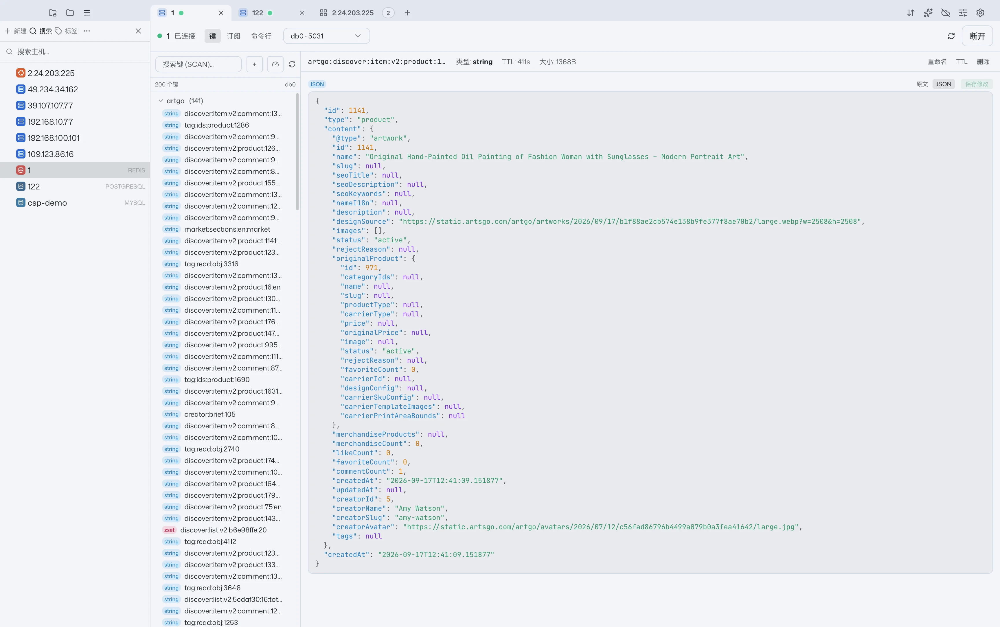

---

<a name="about"></a>
# このプロジェクトについて

本プロジェクトは、オープンソースの [NetCatty](https://github.com/binaricat/NetCatty) をベースに拡張したものです。NetCatty の全機能 — SSH ターミナル、SFTP、モニタリング、ワークスペース、内蔵 AI エージェント — は**そのまま維持**されており、そこに**完全なデータベース層を追加**しました：

- 🗄️ **データベース & Redis GUI クライアント** — Redis（スタンドアロン・クラスター・Sentinel）、MySQL、MariaDB、PostgreSQL、SQLite、SQL Server の 6 種類のワークベンチ。ターミナルと同じウィンドウでタブとして開き、すべての接続に SSH トンネルを設定可能。DBeaver / Navicat からデータベース接続を、Xshell からホストをインポート対応
- 🧠 **データベース対応 AI** — 内蔵 AI アシスタントが開いているデータベース接続を認識：自然言語で SQL を生成 / 最適化 / 修復し、外部 MCP クライアントへのデータベース公開も可能
- 🔄 **アップストリームと同期** — QuollDesk の基本機能（ターミナル、SFTP、モニタリング、テーマなど）の動作は変わりません

> 元の NetCatty の作者 [@binaricat](https://github.com/binaricat) に感謝します。本リポジトリは [artsgo](https://artsgo.com) がメンテナンスしています。

---

<a name="database-clients"></a>
# 🗄️ データベース & Redis クライアント

> 🚀 **ターミナルワークスペースから離れずにデータを管理。** **Redis**（スタンドアロン・クラスター・Sentinel）、**MySQL**、**MariaDB**、**PostgreSQL**、**SQLite**、**SQL Server** の完全な GUI クライアントを提供 — 直接接続または SSH トンネルで接続し、データを視覚的に閲覧・編集、スマート補全でクエリ作成、DDL を手書きせずにテーブル設計。接続はデータベースページでエンジン別にグループ化され、**DBeaver**（`.xml`）や **Navicat**（`.ncx`）からの既存接続インポートにも対応。

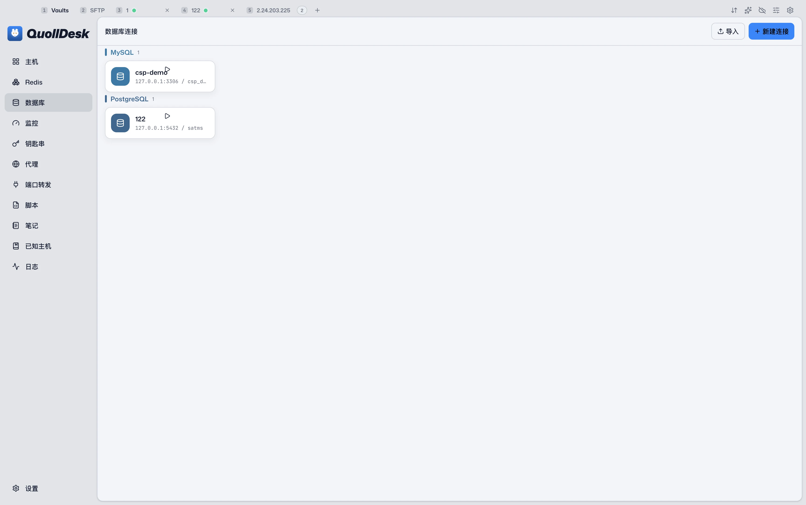

### 🔴 Redis ワークベンチ
- **キー閲覧** — ページング付き SCAN キーツリー、論理 DB 0–65535 切り替え（ライブキー数）、タイプバッジ、名前空間グループ化、大量キーの遅延ロード
- **サーバー概要** — 接続ごとのダッシュボード：サーバー情報、メモリと断片化率、キースペース統計（キー数 / TTL カバー率）、ライブアクティビティ（毎秒操作数ミニチャート、キャッシュヒット率、クライアント数）
- **タイプ別エディター** — string / hash / list / set / zset 専用のビューア & エディター。JSON 值は自動整形 + シンタックスハイライト（ハイライト表示のまま編集可能）
- **ビッグキー分析** — キースペースをタイプ別にスキャンして最大キーを検出し、メモリの热点を特定
- **キー管理** — キーの作成・リネーム・削除、TTL の表示と編集（ライブカウントダウン）
- **Pub/Sub** — チャンネルやパターンを購読し、メッセージをリアルタイム表示
- **コマンドコンソール** — Redis の生コマンドを履歴付きで実行。購読制御コマンドは専用 UI へ誘導
- **クラスター & Sentinel** — クラスターノード一覧とノード単位のキーアクセス。Sentinel トポロジー対応

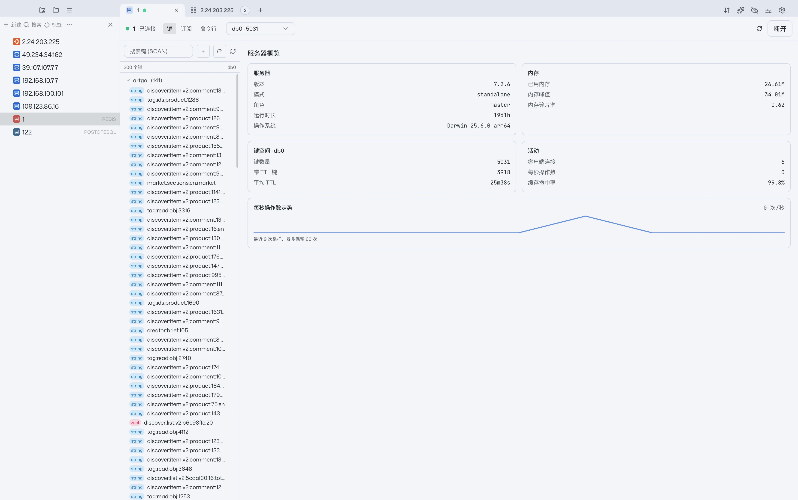

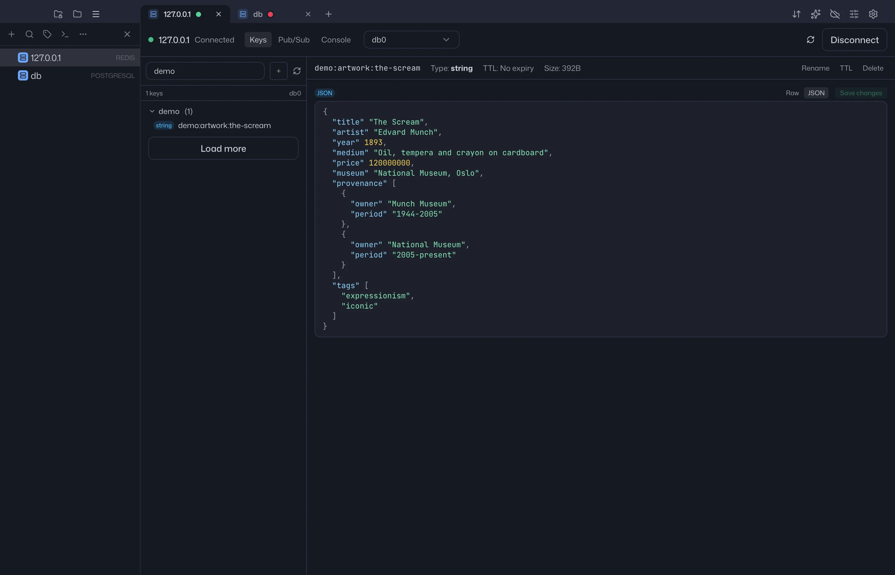

### 🐬 SQL ワークベンチ（MySQL・MariaDB・PostgreSQL・SQLite・SQL Server）
- **7 つのワークベンチビュー** — 概要、ワークベンチ、バックアップ/リストア、セッション、**ER 図**、ロック管理、ユーザー & ロール。関心事ごとにビューを分離
- **スキーマツリー** — データベース/スキーマ、テーブル、ビューを一覧（システムオブジェクトは自動フィルタ）、手動更新対応
- **データグリッド** — ページング、ソート、複数条件フィルタ、GROUP BY 集計とレコードモード；インライン編集はトランザクション方式の**変更を適用**で確定；行追加/削除はバッチ操作対応；FK メタデータとクリックジャンプ
- **BLOB ビューア** — バイナリセルを画像 / PDF / 16 進ダンプで表示、テキストは UTF-8・GB18030・CP1252 などのエンコーディングでデコード
- **インポート & エクスポート** — グリッドとクエリ結果を CSV / JSON / SQL INSERTS でエクスポート；テーブルへの CSV インポートウィザード；SQL バックアップ（データベース全体または単一テーブル、ストリーミング進捗）と `.sql` リストア
- **SQL エディター** — マルチタブ、複数ステートメントの結果タブ分割、バインド変数（`:name` / `?`）、SQL フォーマット、クエリ履歴とお気に入りの永続化
- **スマート補完** — 方言対応のキーワード / テーブル / カラム補完（dt-sql-parser）、ライブ構文エラーの波線
- **EXPLAIN** — エディターからワンクリックで実行計画を表示（MySQL はテーブル、PostgreSQL はテキスト）
- **ER 図** — 自動レイアウトの ER 図。FK リレーションシップ線とカラムコメントをインライン表示；ドラッグで配置、テーブルをクリックしてデータを表示
- **テーブルデザイナー** — 視覚的にテーブルを作成・変更。方言別のタイプリスト；DBeaver 風の複合インデックスエディター（DESC / NULLS / WHERE、PostgreSQL 式、`USING` 方式）；DDL プレビュー + 2 ステップ確認
- **ユーザー & ロール** — アカウント・ロール・権限の管理：PostgreSQL はロール属性とメンバーシップ、MySQL は権限差分比較とバッチ付与/取り消し
- **セッション & ロック** — ライブセッション一覧（強制終了対応）とブロッキング分析のためのロックマネージャー
- **構造ビュー** — カラム、型、デフォルト値、キーとインデックス、完全な `CREATE TABLE` 定義を表示

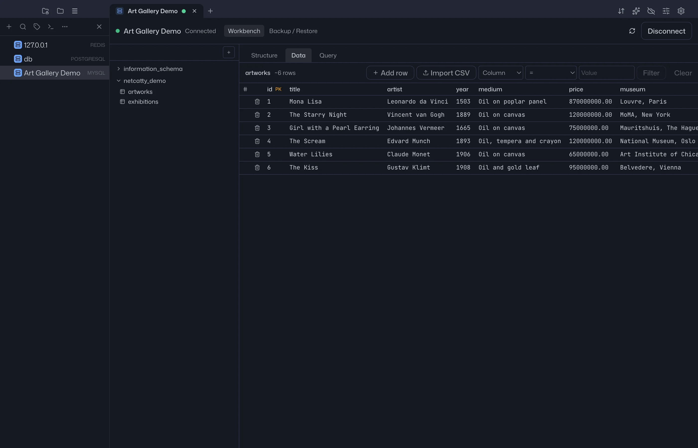

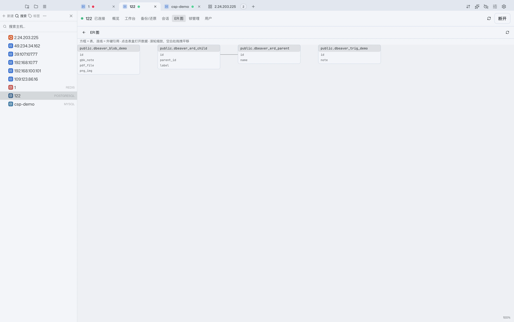

### 🤖 データベース AI & MCP
- **ワークベンチ AI パネル** — 現在の接続にスコープされたチャット。「AI 最適化 / AI 修復」ボタンでエディターの SQL を自然言語プロンプト化し、結果をワンクリックで反映
- **MCP ツール** — 開いているデータベース接続を外部 MCP クライアントへ公開（スキーマ / クエリ / 実行 + Redis キーツール）。マスタースイッチとエージェントの権限モードで管理

---

<a name="quoll-agent"></a>
# 🔥 Quoll Agent — IT オペレーションの AI パートナー

> 🚀 **AI で日常の IT オペレーションを高速化。** Quoll Agent は内蔵 AI アシスタント。サーバーを理解し、コマンドを実行し、複雑なマルチホスト操作を自然な会話で処理します。

### 🔥 Quoll Agent にできること

- 🚀 **自然言語でのサーバー管理** — 必要なことを伝えるだけ。コマンドの暗記は不要
- 🔥 **リアルタイムサーバー診断** — ステータス確認、ログ調査、リソース監視を会話で
- 🚀 **マルチホスト オーケストレーション** — 複数サーバーのタスクを同時協調実行
- 🔥 **インテリジェントなコンテキスト認識** — サーバー環境を理解し、的確な回答を提供
- 🚀 **ワンクリックの複雑操作** — クラスター構築やサービス デプロイも一言で

### 🎬 AI の実行デモ

#### 🔥 単一ホスト — インテリジェントなサーバー診断

Quoll Agent にサーバーの健康状態を確認させると、適切なコマンドを実行し、出力を分析して明確なサマリーを数秒で返します。

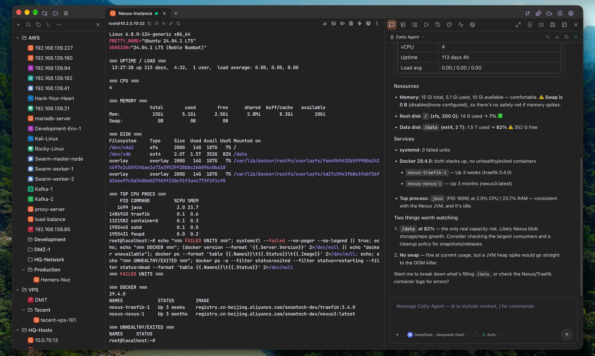

#### 🚀 マルチホスト — Docker Swarm クラスター構築

Quoll Agent が 2 台のサーバーにまたがる Docker Swarm クラスターを一つの会話で構築する様子：init、トークン交換、ノード参加をすべて自動処理 — あなたは目標を伝えるだけ。

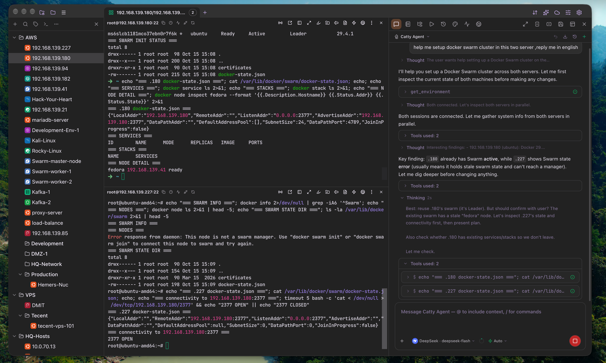

---

# 目次 <!-- omit in toc -->

- [このプロジェクトについて](#about)
- [🗄️ データベース & Redis クライアント](#database-clients)
- [🔥 Quoll Agent — AI パートナー](#quoll-agent)
- [基本機能（QuollDesk）](#base-features)
- [スクリーンショット](#screenshots)
- [対応ディストリビューション](#supported-distros)
- [はじめに](#getting-started)
- [ビルド & パッケージ](#build--package)
- [技術スタック](#tech-stack)
- [コントリビュート](#contributing)
- [ライセンス](#license)

---

<a name="base-features"></a>
# 基本機能（QuollDesk）

以下はすべて QuollDesk 由来の機能で、本エディションでもそのまま動作します。

### 🗂️ Vault ホスト管理
- **複数ビュー** — グリッド / リスト / ツリー
- **インポート** — Xshell（`.xsh`）エクスポートからホストを、DBeaver / Navicat からデータベース接続を取り込み
- **高速検索** — ホストとグループを素早く検索

### 🖥️ ターミナルワークスペース
- **分割ペイン** — 水平/垂直分割でマルチタスク
- **セッション管理** — 複数接続を並行実行、保存と復元
- **現在の画面を保存** — ターミナルを右クリックして表示中の最終テキストを保存
- **インライン画像** — Kitty graphics、SIXEL、iTerm インライン画像をレンダリング

### 📁 SFTP + 内蔵エディター
- **ファイルワークフロー** — ドラッグ & ドロップでアップ/ダウンロード
- **その場で編集** — 内蔵エディターで素早く修正
- **リモートアーカイブ作成** — 選択したファイル/フォルダーを右クリックで `.tar.gz` または `.zip` に圧縮

### 📊 モニタリング
- CPU / メモリ / ディスク / ネットワーク / レイテンシ（利用可能なら GPU も含む）、最短 1 秒間隔の更新、監視中ホストからターミナルを直接開く

### 🎨 パーソナライズ
- **カスタムテーマ** — アプリの見た目を好みに調整
- **キーワードハイライト** — ターミナル出力のハイライトルールをカスタマイズ

---

<a name="screenshots"></a>
# スクリーンショット

## メインウィンドウ

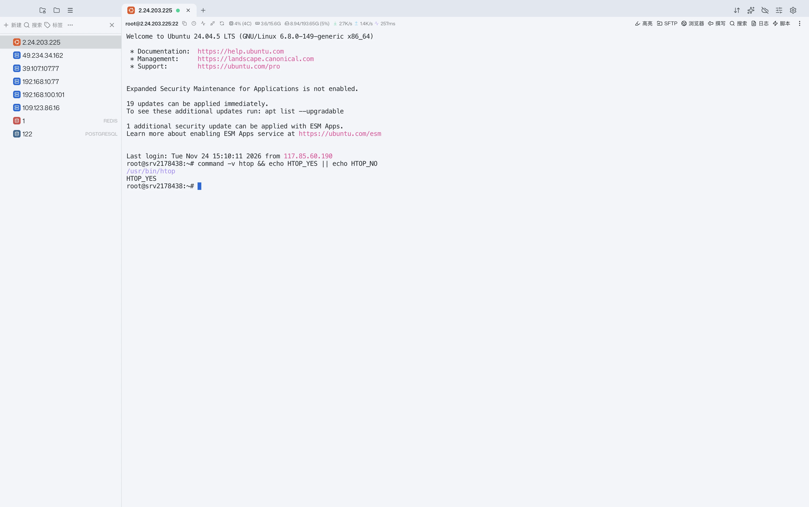

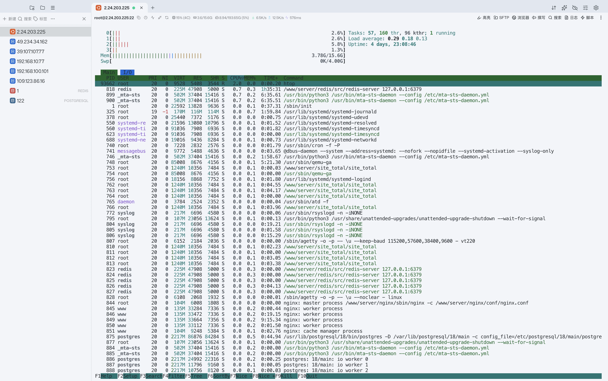

## Vault ビュー

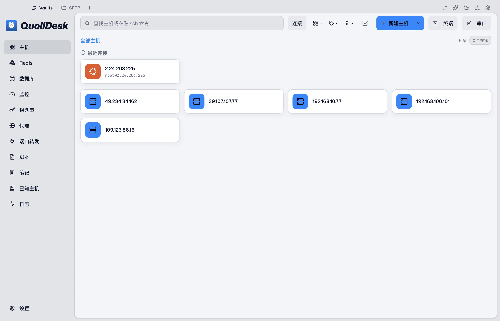

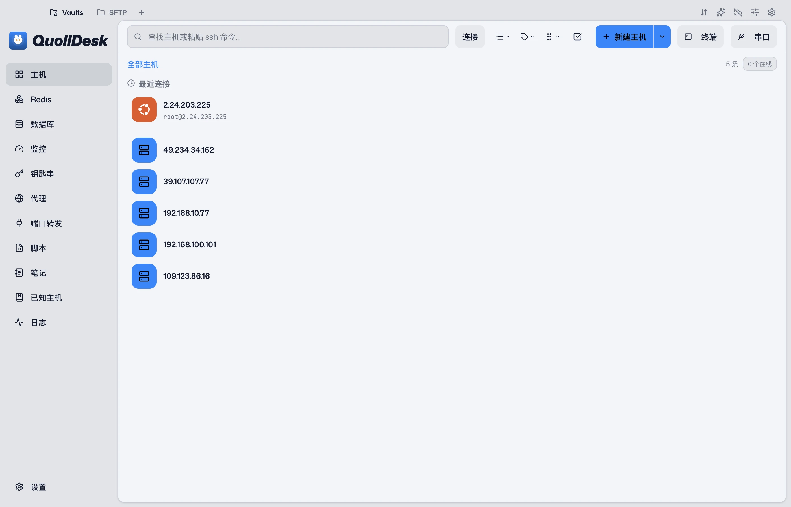

## モニタリングビュー

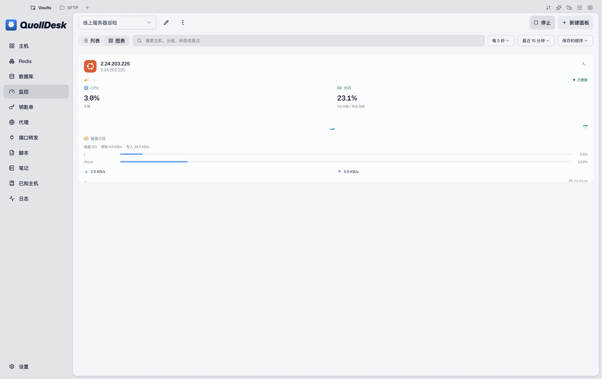

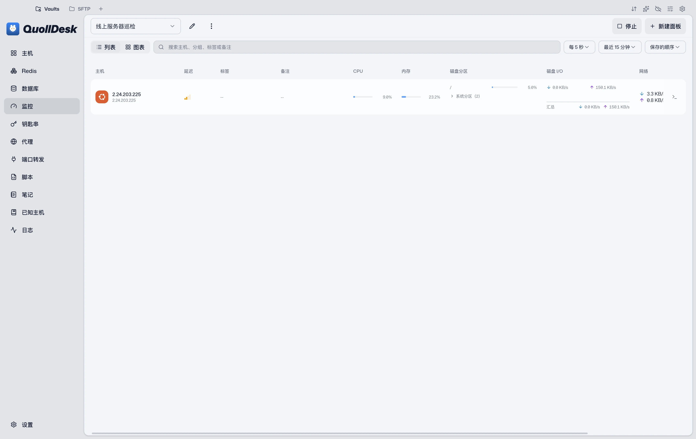

## 分割ターミナル

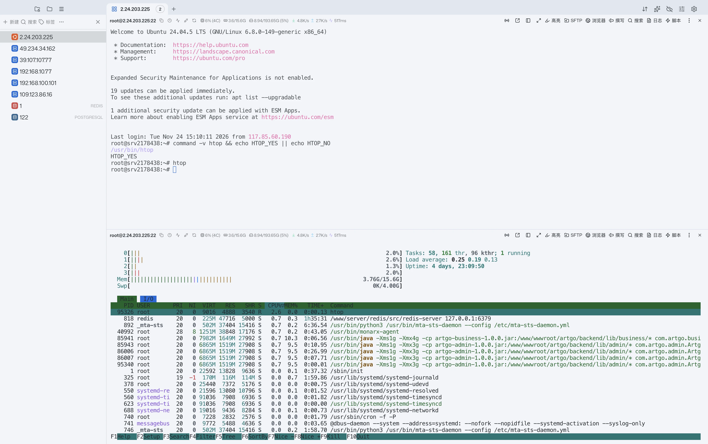

---

<a name="supported-distros"></a>
# 対応ディストリビューション

QuollDesk は接続先ホストの OS アイコンを自動判定して表示します：

<p align="center">
  
  
  
  
  
  
  
  
  
  
  
  
  
</p>

<a name="getting-started"></a>
# はじめに

### ダウンロード

お使いのプラットフォーム向けの最新版を [GitHub Releases](https://github.com/artsgoofficial/QuollDesk/releases/latest) からダウンロードしてください。

| OS | サポート |
| :--- | :--- |
| **macOS** | Universal（x64 / arm64） |
| **Windows** | x64 / arm64 |
| **Linux** | x64 / arm64 |

### コード署名とプライバシー

QuollDesk は SignPath Foundation のオープンソースプログラムに申請中です。承認されれば、対象の Windows リリース成果物に **SignPath.io による無料コード署名（証明書は SignPath Foundation）** が使用されます。詳細は[コード署名ポリシー](CODE_SIGNING_POLICY.md)と[プライバシーポリシー](PRIVACY.md)を参照。申請と統合が完了するまで、Windows リリースは未署名のままの場合があります。

> **Windows ポータブル版のデータ**：QuollDesk を終了し、`QuollDesk.exe`（zip 版）やポータブルランチャーの隣に `data` という名前のフォルダーを作成すると、次回起動時にそのフォルダーへプロファイルが保存されます。

> **Windows で QuollDesk からフォルダーを開く**：インストール版はエクスプローラーのフォルダーコンテキストメニューに **Open in QuollDesk** を追加します。メニューのオン/オフは **設定 → システム → Windows エクスプローラー** で切り替えられます。

> **macOS ユーザーへ**：現在のリリースはコード署名・公証済みです。Gatekeeper が警告する場合は、GitHub Releases から最新の公式ビルドをダウンロードしているか確認してください。

<a name="open-a-local-terminal-from-the-command-line"></a>
### コマンドラインからローカルターミナルを開く

`--open-terminal-path <dir>` で指定フォルダー内にローカルターミナルを開きます。`--open-terminal-shell <id-or-path>` でシェルを選択（`pwsh`、`cmd`、`wsl-ubuntu` などの ID、またはシェル実行ファイルのパス）。どちらか一方でも動作し、QuollDesk が既に起動中ならそのウィンドウでタブが開きます。

Windows では Electron にフラグを転送するため追加の `--` が必要です：

```bat
QuollDesk.exe -- --open-terminal-shell=pwsh --open-terminal-path="D:\\proj"
```

macOS は `open` で新インスタンスを起動するか、バイナリを直接実行します：

```bash
open -n -a QuollDesk --args --open-terminal-shell=zsh --open-terminal-path="$HOME/proj"
/Applications/QuollDesk.app/Contents/MacOS/QuollDesk --open-terminal-shell=zsh --open-terminal-path="$HOME/proj"
```

### Scoop（Windows x64、コミュニティメンテナンス）

[Scoop](https://scoop.sh/) 導入済みなら、コミュニティ管理の [lemon bucket](https://github.com/hoilc/scoop-lemon/blob/master/bucket/quolldesk.json) から QuollDesk をインストールできます：

```powershell
scoop bucket add lemon https://github.com/hoilc/scoop-lemon
scoop install lemon/quolldesk
```

### Nix / NixOS

公式 Linux AppImage リリースをラップした flake を提供しています：

```bash
nix run github:artsgoofficial/QuollDesk
```

### 必要要件
- Node.js 18+ と npm
- macOS、Windows 10+、または Linux

### 開発

```bash
# リポジトリをクローン
git clone https://github.com/artsgoofficial/QuollDesk.git
cd QuollDesk

# 依存関係をインストール（同梱パッチが適用されます — postinstall は有効のままにしてください）
npm install

# 開発モードを起動（Vite + Electron）
npm run dev
```

---

<a name="build--package"></a>
# ビルド & パッケージ

```bash
# 本番ビルド
npm run build

# 現在のプラットフォーム向けにパッケージ
npm run pack

# 特定プラットフォーム向けにパッケージ
npm run pack:mac     # macOS（DMG + ZIP）
npm run pack:win     # Windows（NSIS インストーラー）
npm run pack:linux   # Linux（AppImage + DEB + RPM）
```

---

<a name="tech-stack"></a>
# 技術スタック

| カテゴリ | 技術 |
|----------|------------|
| フレームワーク | Electron 40 |
| フロントエンド | React 19, TypeScript |
| ビルドツール | Vite 7 |
| ターミナル | xterm.js 5 |
| スタイリング | Tailwind CSS 4 |
| SSH/SFTP | ssh2, ssh2-sftp-client |
| PTY | node-pty |
| データベース | redis (node-redis), mysql2, pg, mssql, node:sqlite, dt-sql-parser, sql-formatter |
| アイコン | Lucide React |

---

<a name="contributing"></a>
# コントリビュート

コントリビューションを歓迎します！Pull Request をお気軽にどうぞ。

1. リポジトリをフォーク
2. フィーチャーブランチを作成（`git checkout -b feature/amazing-feature`）
3. 変更をコミット（`git commit -m 'Add some amazing feature'`）
4. ブランチをプッシュ（`git push origin feature/amazing-feature`）
5. Pull Request をオープン

アーキテクチャ概要とコーディング規約は [AGENTS.md](AGENTS.md) を参照。

---

<a name="license"></a>
# ライセンス

本プロジェクトは **GPL-3.0 License** の下で公開されています。詳細は [LICENSE](LICENSE) を参照。

---

<p align="center">
  Based on <a href="https://github.com/binaricat/NetCatty">NetCatty</a> · Extended and maintained with ❤️ by <a href="https://artsgo.com">artsgo</a> · Support us at <a href="https://artsgo.com">artsgo.com</a> 🎨
</p>
