<p align="center">
  
</p>

<h1 align="center">QuollDesk</h1>

<p align="center">
  <strong>🔥 An enhanced edition of QuollDesk — AI SSH workspace extended with full Redis / MySQL / PostgreSQL GUI clients 🚀</strong><br/>
  <a href="https://quolldesk.app"><strong>quolldesk.app</strong></a>
</p>

<p align="center">
  <a href="https://github.com/artsgoofficial/QuollDesk/releases/latest"></a>
  &nbsp;
  <a href="#"></a>
  &nbsp;
  <a href="LICENSE"></a>
</p>

<p align="center">
  <a href="https://github.com/artsgoofficial/QuollDesk/releases/latest">
    
  </a>
</p>

<p align="center">
  <a href="https://artsgo.com"></a>
</p>

<p align="center">
  💝 If QuollDesk helps you, please support us at <a href="https://artsgo.com"><strong>artsgo.com</strong></a> — our online marketplace for original artworks. Every visit helps!
</p>

<p align="center">
  <a href="./README.md">English</a> · <a href="./README.zh-CN.md">简体中文</a> · <a href="./README.zh-TW.md">繁體中文</a> · <a href="./README.ja-JP.md">日本語</a>
</p>

---

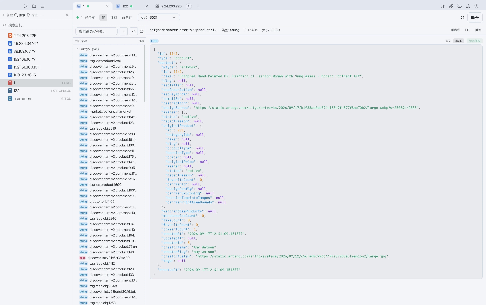

---

<a name="about"></a>
# About this project

This project is an **enhanced edition built on top of [NetCatty](https://github.com/binaricat/NetCatty)**, the open-source AI-powered SSH client. Everything NetCatty does — SSH terminals, SFTP, monitoring, workspaces, the built-in AI agent — is fully retained, and this edition **extends it with a complete database layer**:

- 🗄️ **Database & Redis GUI clients** — Redis (standalone, cluster & Sentinel), MySQL, MariaDB, PostgreSQL, SQLite and SQL Server workbenches that open as tabs inside the same workspace, with optional SSH tunneling for every connection. Import existing connections from DBeaver or Navicat, and hosts from Xshell
- 🧠 **Database-aware AI** — the built-in agent understands your open database connections: generate / optimize / fix SQL from natural language, and expose databases to external MCP clients
- 🔄 **Kept in sync with upstream** — base QuollDesk features (terminals, SFTP, monitoring, themes) continue to work exactly as before

> Credit and thanks to [@binaricat](https://github.com/binaricat) for the original NetCatty. This repository is maintained by [artsgo](https://artsgo.com).

---

<a name="database-clients"></a>
# 🗄️ Database & Redis Clients

> 🚀 **Manage your data without leaving your terminal workspace.** Full GUI clients for **Redis** (standalone, cluster & Sentinel), **MySQL**, **MariaDB**, **PostgreSQL**, **SQLite**, and **SQL Server** — connect directly or over SSH tunnels, browse and edit data visually, run queries with smart completion, and design tables without hand-writing DDL. Connections are grouped by engine in the vault, and existing connections can be imported from **DBeaver** (`.xml`) or **Navicat** (`.ncx`).

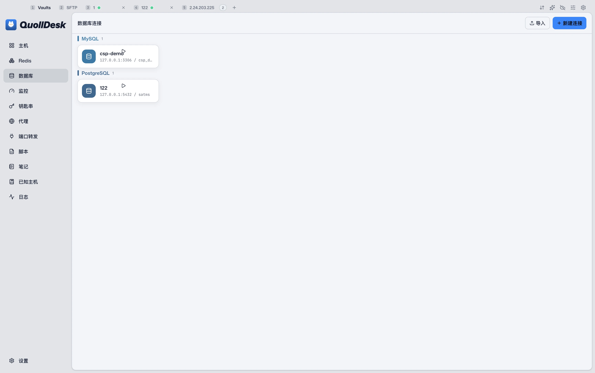

### 🔴 Redis Workbench
- **Key browsing** — paged SCAN key tree with logical db selector (0–65535, live key counts) and type badges; namespace grouping and lazy loading for large keyspaces
- **Server overview** — per-connection dashboard: server info, memory & fragmentation, keyspace stats (keys, TTL coverage) and live activity (ops/sec mini-chart, cache hit rate, client count)
- **Per-type editors** — dedicated viewers/editors for string, hash, list, set and zset values; JSON values auto pretty-print with syntax highlighting (still editable while colored)
- **Big-key analysis** — scan a keyspace for the largest keys by type to find memory hogs
- **Key management** — create, rename, delete keys; view and edit TTL with live countdown
- **Pub/Sub** — subscribe to channels or patterns and watch messages arrive live
- **Command console** — raw Redis commands with history; dangerous subscription-control commands are routed to the dedicated UI
- **Cluster & Sentinel** — cluster node listing and per-node key access; Sentinel-aware topologies

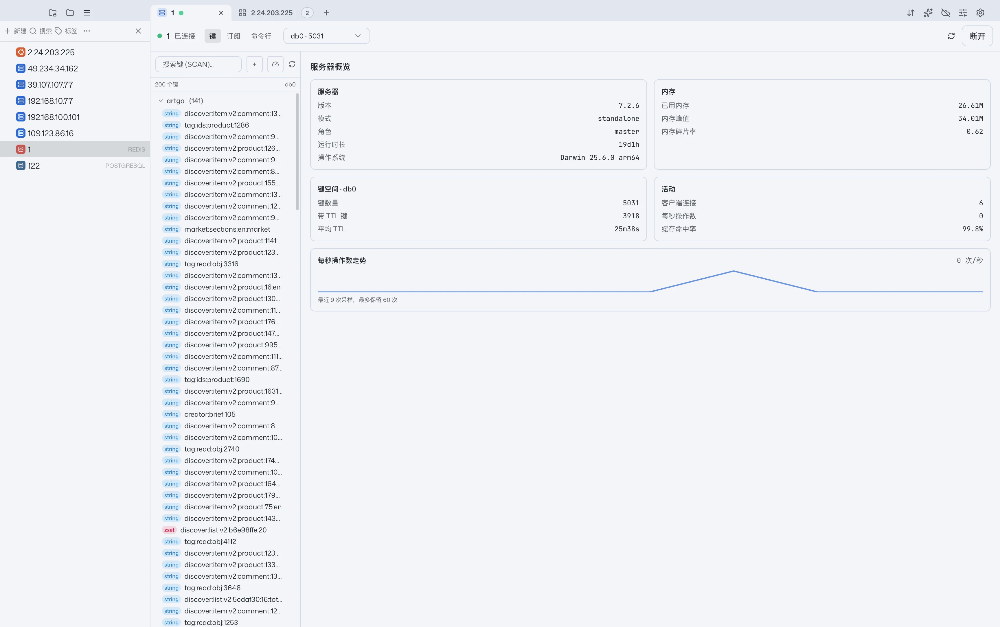

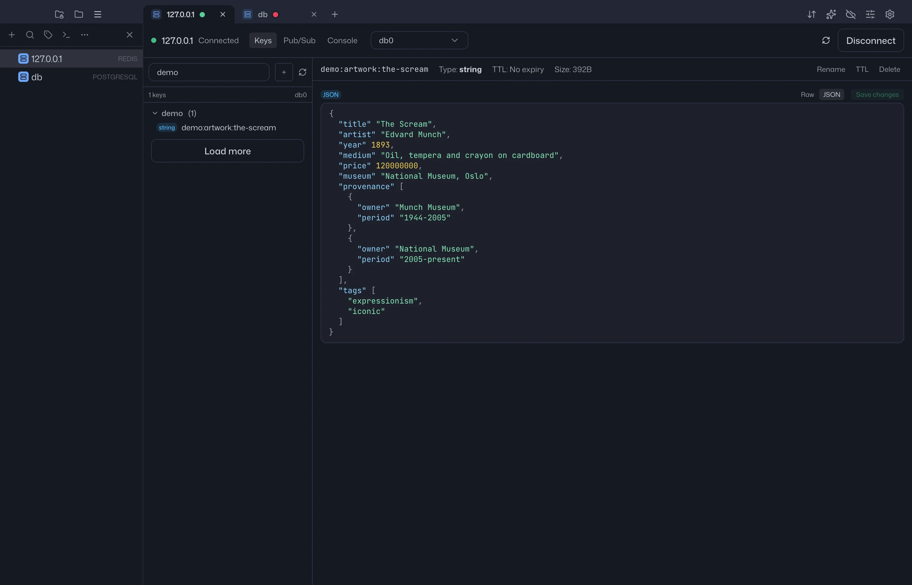

### 🐬 SQL Workbench (MySQL, MariaDB, PostgreSQL, SQLite & SQL Server)
- **Seven workbench views** — Overview dashboard, Workbench, Backup/Restore, Sessions, **ER diagrams**, Lock manager and Users & Roles, one tab per concern
- **Schema tree** — databases/schemas, tables and views at a glance (system objects filtered out); refresh on demand
- **Data grid** — paged, sortable, multi-condition filtering, GROUP BY summaries and a record mode; inline cell editing staged into a transactional **Apply changes**; add/delete rows with batch operations; FK metadata with click-through navigation
- **BLOB viewer** — open binary cells as image / PDF / hex dump, or decode text in UTF-8, GB18030, CP1252 and more
- **Import & export** — export grids and query results to CSV / JSON / SQL INSERTs; guided CSV import wizard into any table; streamed SQL backup (whole database or single table, live progress) and restore from `.sql` files
- **SQL editor** — multi-tab with multi-statement result tabs, bind variables (`:name` / `?`), SQL formatting, persisted query history and favorites
- **Smart completion** — dialect-aware autocompletion for keywords, tables and columns (dt-sql-parser), with live syntax-error squiggles
- **EXPLAIN** — tabular plan for MySQL, text plan for PostgreSQL, one click from the editor
- **ER diagrams** — auto-layout entity relationship diagrams with FK relationship lines and inline column comments; drag to arrange, click a table to open its data
- **Table designer** — create and alter tables visually with dialect-specific type lists; DBeaver-style composite index editor (DESC / NULLS / WHERE, PostgreSQL expressions, `USING` method); DDL preview, two-step confirm before execution
- **Users & Roles** — manage accounts, roles and grants: PostgreSQL role attributes & memberships, MySQL privilege diffing with batch grant/revoke
- **Sessions & locks** — live session list with terminate, and a lock manager for blocking analysis
- **Structure view** — columns, types, defaults, keys and indexes with the full `CREATE TABLE` definition

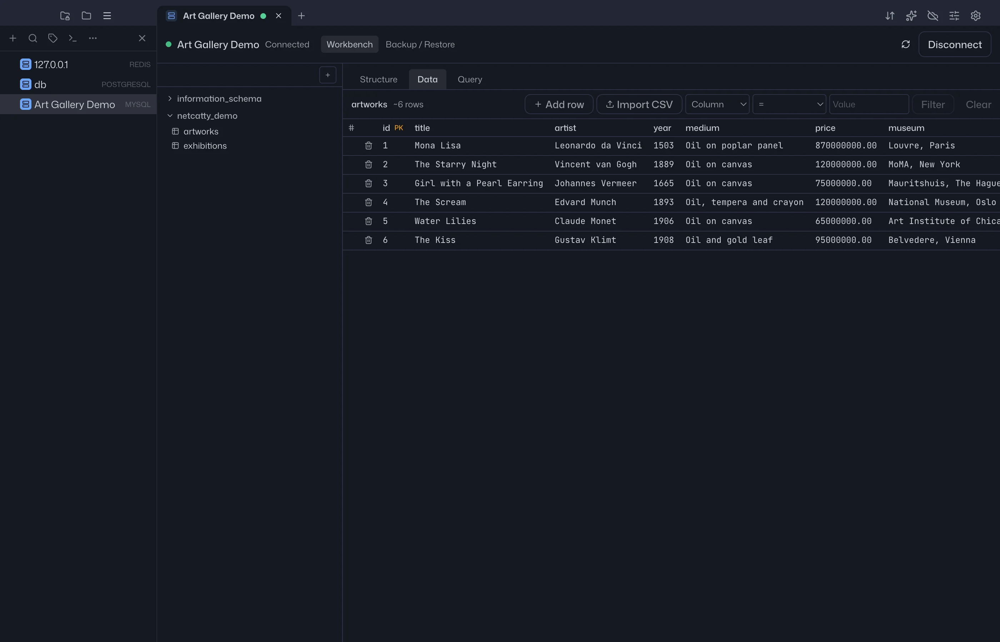

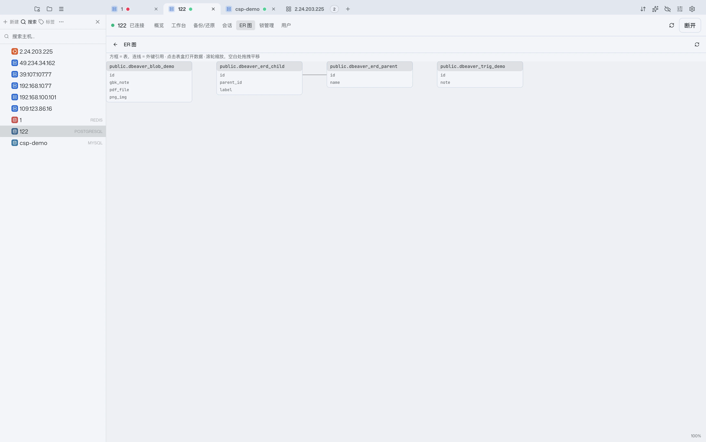

### 🤖 Database AI & MCP
- **Workbench AI panel** — chat scoped to the current connection; AI 优化 / AI 修复 buttons turn the editor's SQL into natural-language prompts and write results back
- **MCP tools** — expose currently-open database connections to external MCP clients (schema/query/execute + Redis key tools), gated by a master switch and the same permission modes as the agent

---

<a name="quoll-agent"></a>
# 🔥 Quoll Agent — Your IT Ops AI Partner

> 🚀 **Boost your IT ops daily work with AI power.** Quoll Agent is the built-in AI assistant that understands your servers, executes commands, and handles complex multi-host operations — all through natural conversation.

### 🔥 What can Quoll Agent do?

- 🚀 **Natural language server management** — just tell it what you need, no more memorizing commands
- 🔥 **Real-time server diagnostics** — check status, inspect logs, monitor resources through conversation
- 🚀 **Multi-host orchestration** — coordinate tasks across multiple servers simultaneously
- 🔥 **Intelligent context awareness** — understands your server environment and provides tailored responses
- 🚀 **One-click complex operations** — set up clusters, deploy services, and more with simple instructions

### 🎬 AI in Action

#### 🔥 Single Host — Intelligent Server Diagnostics

Ask Quoll Agent to check a server's health, and it runs the right commands, analyzes the output, and gives you a clear summary — all in seconds.

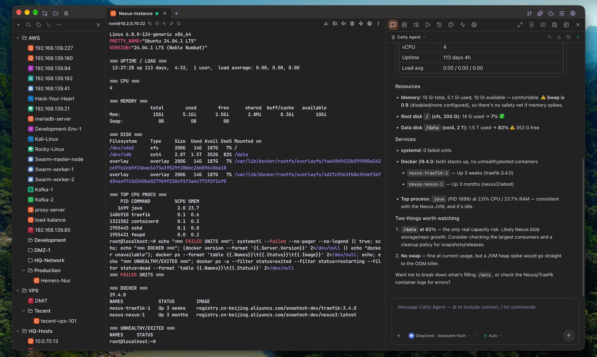

#### 🚀 Multi-Host — Docker Swarm Cluster Setup

Watch Quoll Agent orchestrate a Docker Swarm cluster across two servers in one conversation. It handles the init, token exchange, and node joining — you just tell it what you want.

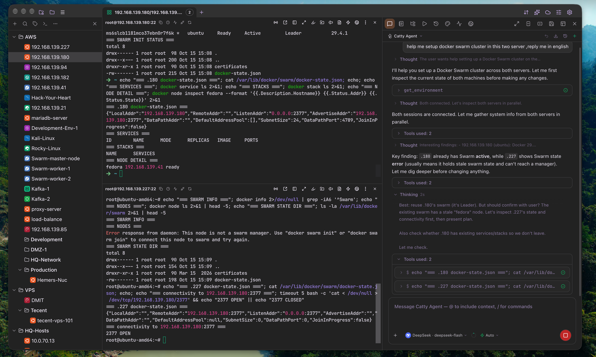

---

# Contents <!-- omit in toc -->

- [About this project](#about)
- [🗄️ Database & Redis Clients](#database-clients)
- [🔥 Quoll Agent — AI Partner](#quoll-agent)
- [Base Features (QuollDesk)](#base-features)
- [Screenshots](#screenshots)
- [Supported Distros](#supported-distros)
- [Getting Started](#getting-started)
- [Build & Package](#build--package)
- [Tech Stack](#tech-stack)
- [Contributing](#contributing)
- [License](#license)

---

<a name="base-features"></a>
# Base Features (QuollDesk)

Everything below comes from base QuollDesk and works unchanged in this edition.

### 🗂️ Vault
- **Multiple views** — grid / list / tree
- **Fast search** — locate hosts and groups quickly
- **Import** — bring hosts in from Xshell (`.xsh`) exports, database connections from DBeaver / Navicat

### 🖥️ Terminal Workspaces
- **Split panes** — horizontal and vertical splits for multi-tasking
- **Session management** — run multiple connections side-by-side, saved and restored
- **Save current screen** — right-click a terminal to save the visible final text
- **Inline images** — render Kitty graphics, SIXEL and iTerm inline images from remote programs

### 📁 SFTP + Built-in Editor
- **File workflows** — drag & drop uploads/downloads
- **Edit in place** — built-in editor for quick changes
- **Create remote archives** — compress selections to `.tar.gz` or `.zip` from the right-click menu

### 📊 Monitoring
- CPU / memory / disk / network / latency with GPU details where available, refresh down to 1 second, open a terminal straight from a monitored host

### 🎨 Personalization
- **Custom themes** — tune the app appearance to your taste
- **Keyword highlighting** — customize highlight rules for terminal output

---

<a name="screenshots"></a>
# Screenshots

## Main Window & Terminal

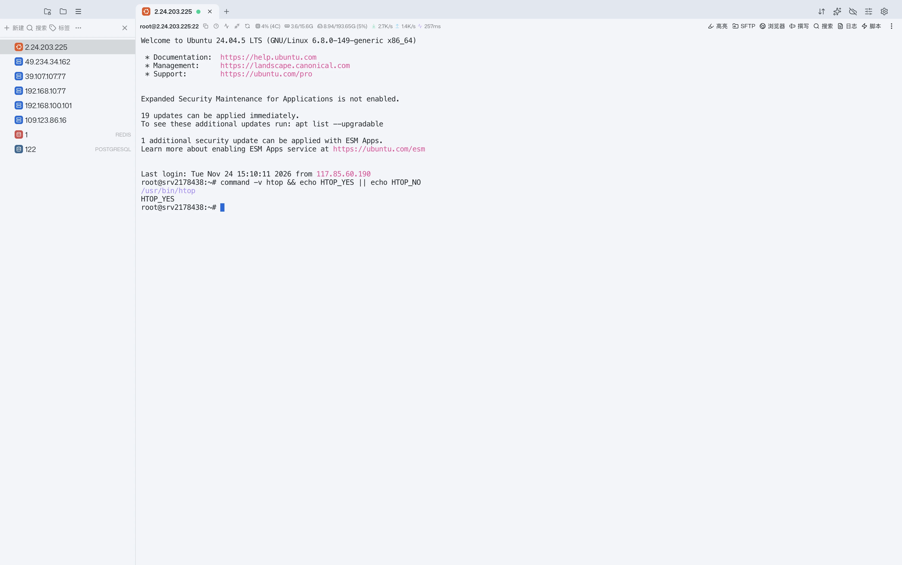

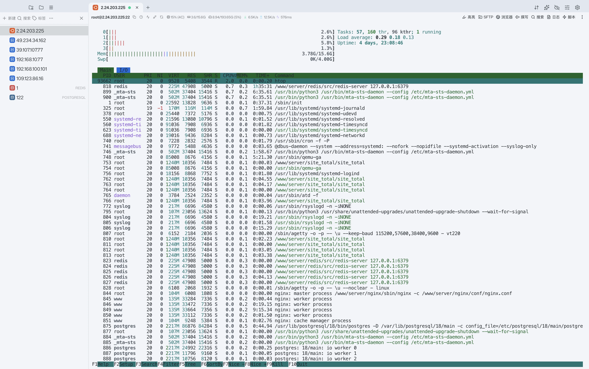

## Vault Views

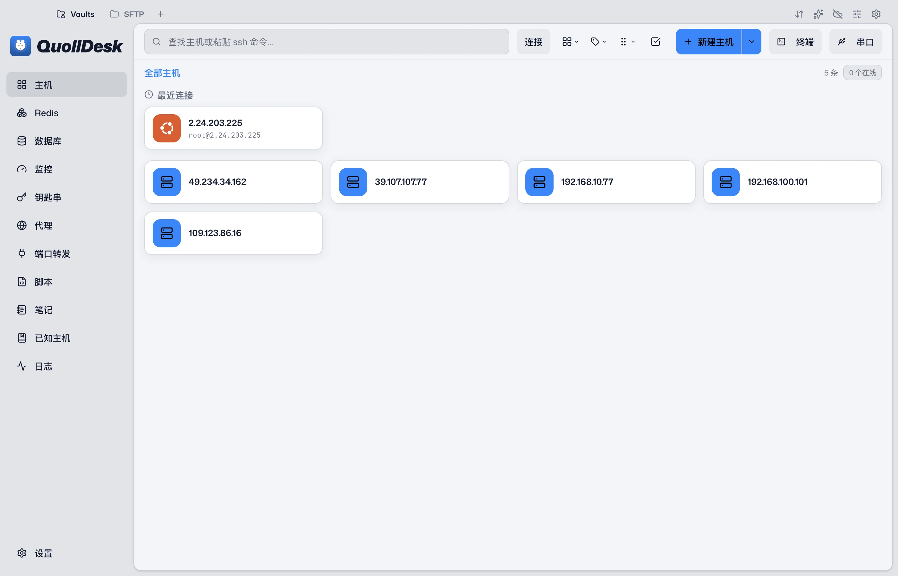

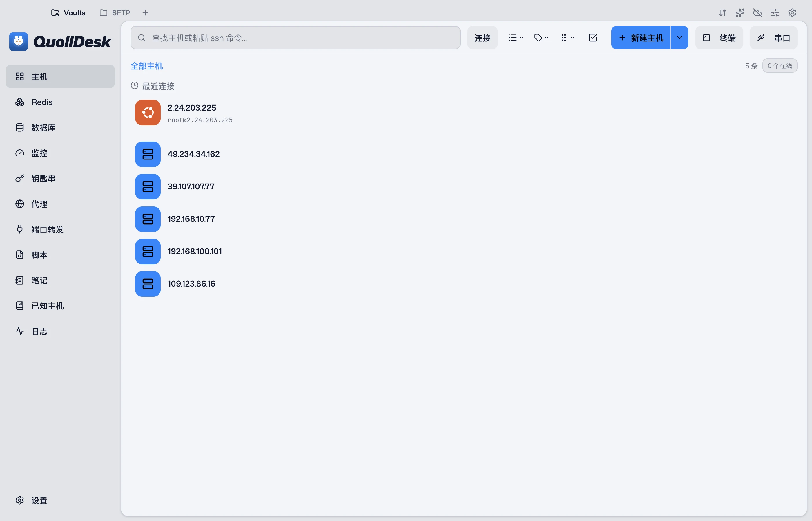

## Monitoring View

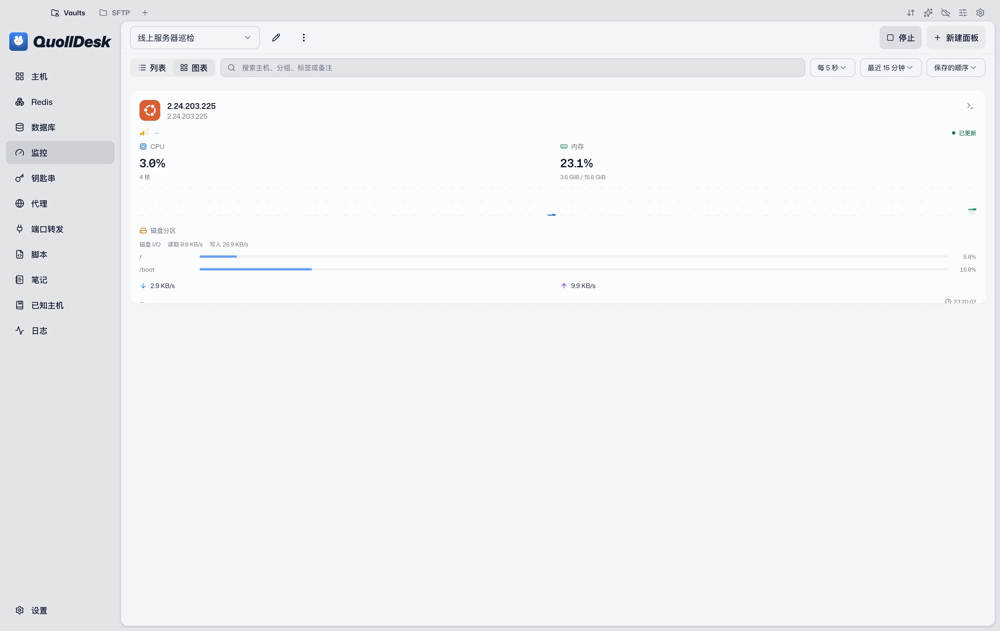

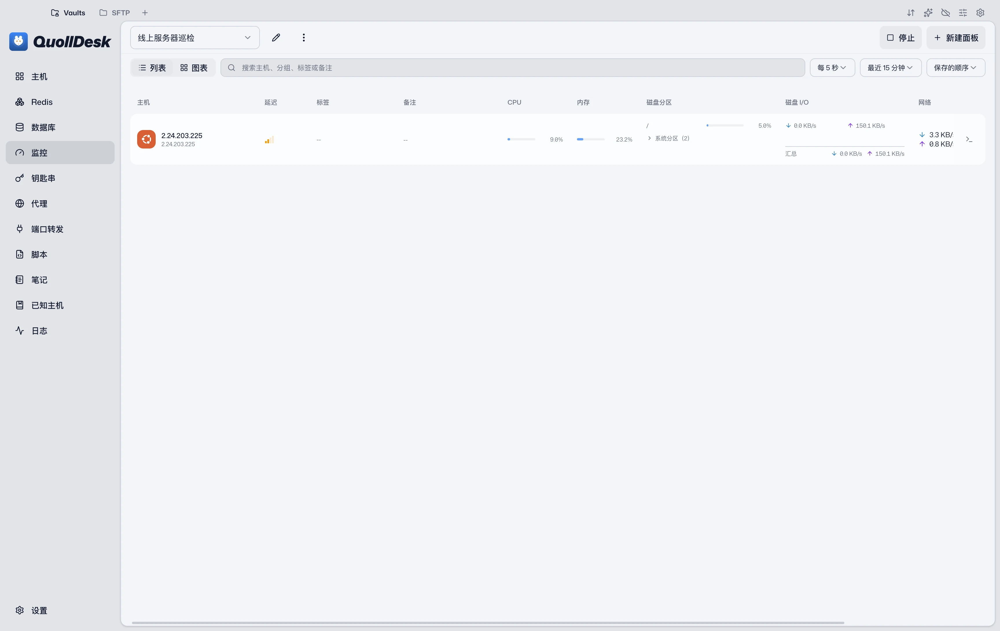

## Split Terminals

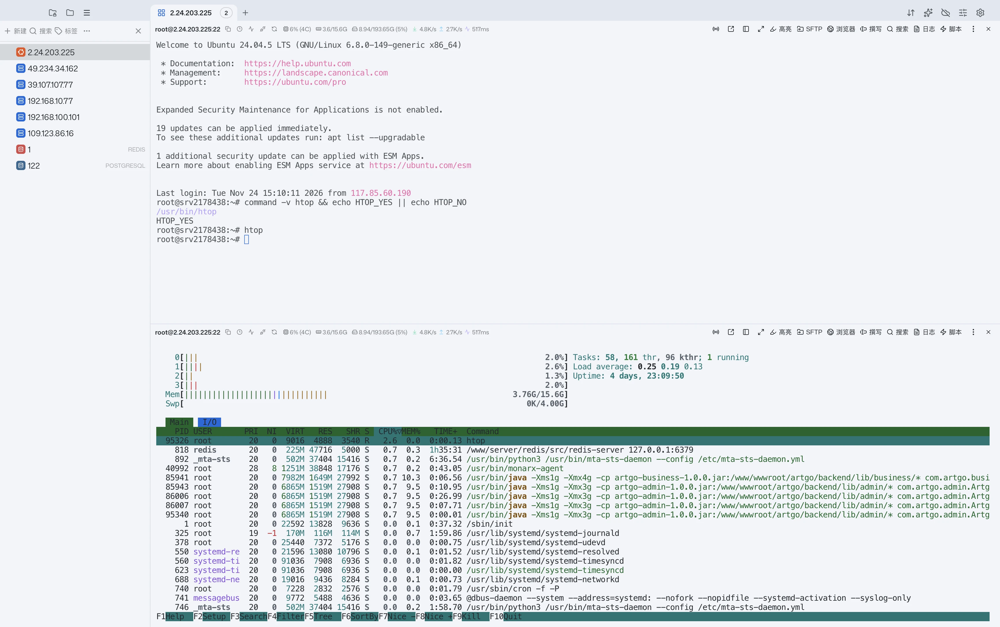

---

<a name="supported-distros"></a>
# Supported Distros

QuollDesk automatically detects and displays OS icons for connected hosts:

<p align="center">
  
  
  
  
  
  
  
  
  
  
  
  
  
</p>

<a name="getting-started"></a>
# Getting Started

### Download

Download the latest release for your platform from [GitHub Releases](https://github.com/artsgoofficial/QuollDesk/releases/latest).

| OS | Support |
| :--- | :--- |
| **macOS** | Universal (x64 / arm64) |
| **Windows** | x64 / arm64 |
| **Linux** | x64 / arm64 |

### Code signing and privacy

QuollDesk is applying to the SignPath Foundation open-source program. Once
approved, covered Windows release artifacts will use **Free code signing provided by SignPath.io, certificate by SignPath Foundation**.
See the [code signing policy](CODE_SIGNING_POLICY.md) and
[privacy policy](PRIVACY.md). Windows releases may remain unsigned until the
application and integration are complete.

> **Windows portable data:** Exit QuollDesk, then create a folder named `data` beside `QuollDesk.exe` (zip build) or beside the portable launcher. QuollDesk will store its profile there on the next launch.

> **Open folders in QuollDesk on Windows:** The installed version adds **Open in QuollDesk** to Explorer's folder context menu. Turn the menu off or on in **Settings → System → Windows Explorer**.

> **macOS Users:** Current releases are expected to be code-signed and notarized. If Gatekeeper still warns, make sure you downloaded the latest official build from GitHub Releases.

<a name="open-a-local-terminal-from-the-command-line"></a>
### Open a local terminal from the command line

`--open-terminal-path <dir>` opens a local terminal in that folder. `--open-terminal-shell <id-or-path>` selects the shell: a discovered id such as `pwsh`, `cmd`, or `wsl-ubuntu`, or a path to a shell executable. Either flag is enough. If QuollDesk is already running, the tab opens in that window.

Windows needs an extra `--` so Electron forwards the flags:

```bat
QuollDesk.exe -- --open-terminal-shell=pwsh --open-terminal-path="D:\\proj"
```

On macOS, start a new instance with `open`, or run the binary directly:

```bash
open -n -a QuollDesk --args --open-terminal-shell=zsh --open-terminal-path="$HOME/proj"
/Applications/QuollDesk.app/Contents/MacOS/QuollDesk --open-terminal-shell=zsh --open-terminal-path="$HOME/proj"
```

### Scoop (Windows x64, community-maintained)

With [Scoop](https://scoop.sh/) installed, you can install QuollDesk from the community-maintained [lemon bucket](https://github.com/hoilc/scoop-lemon/blob/master/bucket/quolldesk.json):

```powershell
scoop bucket add lemon https://github.com/hoilc/scoop-lemon
scoop install lemon/quolldesk
```

### Nix / NixOS

QuollDesk provides a flake that wraps the official Linux AppImage release:

```bash
nix run github:artsgoofficial/QuollDesk
```

### Prerequisites
- Node.js 18+ and npm
- macOS, Windows 10+, or Linux

### Development

```bash
# Clone the repository
git clone https://github.com/artsgoofficial/QuollDesk.git
cd QuollDesk

# Install dependencies (applies bundled patches — keep postinstall enabled)
npm install

# Start development mode (Vite + Electron)
npm run dev
```

---

<a name="build--package"></a>
# Build & Package

```bash
# Build for production
npm run build

# Package for current platform
npm run pack

# Package for specific platforms
npm run pack:mac     # macOS (DMG + ZIP)
npm run pack:win     # Windows (NSIS installer)
npm run pack:linux   # Linux (AppImage + DEB + RPM)
```

---

<a name="tech-stack"></a>
# Tech Stack

| Category | Technology |
|----------|------------|
| Framework | Electron 40 |
| Frontend | React 19, TypeScript |
| Build Tool | Vite 7 |
| Terminal | xterm.js 5 |
| Styling | Tailwind CSS 4 |
| SSH/SFTP | ssh2, ssh2-sftp-client |
| PTY | node-pty |
| Databases | redis (node-redis), mysql2, pg, mssql, node:sqlite, dt-sql-parser, sql-formatter |
| Icons | Lucide React |

---

<a name="contributing"></a>
# Contributing

Contributions are welcome! Please feel free to submit a Pull Request.

1. Fork the repository
2. Create your feature branch (`git checkout -b feature/amazing-feature`)
3. Commit your changes (`git commit -m 'Add some amazing feature'`)
4. Push to the branch (`git push origin feature/amazing-feature`)
5. Open a Pull Request

See [AGENTS.md](AGENTS.md) for architecture overview and coding conventions.

---

<a name="license"></a>
# License

This project is licensed under the **GPL-3.0 License** - see the [LICENSE](LICENSE) file for details.

---

<p align="center">
  Based on <a href="https://github.com/binaricat/NetCatty">NetCatty</a> · Extended and maintained with ❤️ by <a href="https://artsgo.com">artsgo</a> · Support us at <a href="https://artsgo.com">artsgo.com</a> 🎨
</p>
