<p align="center">
  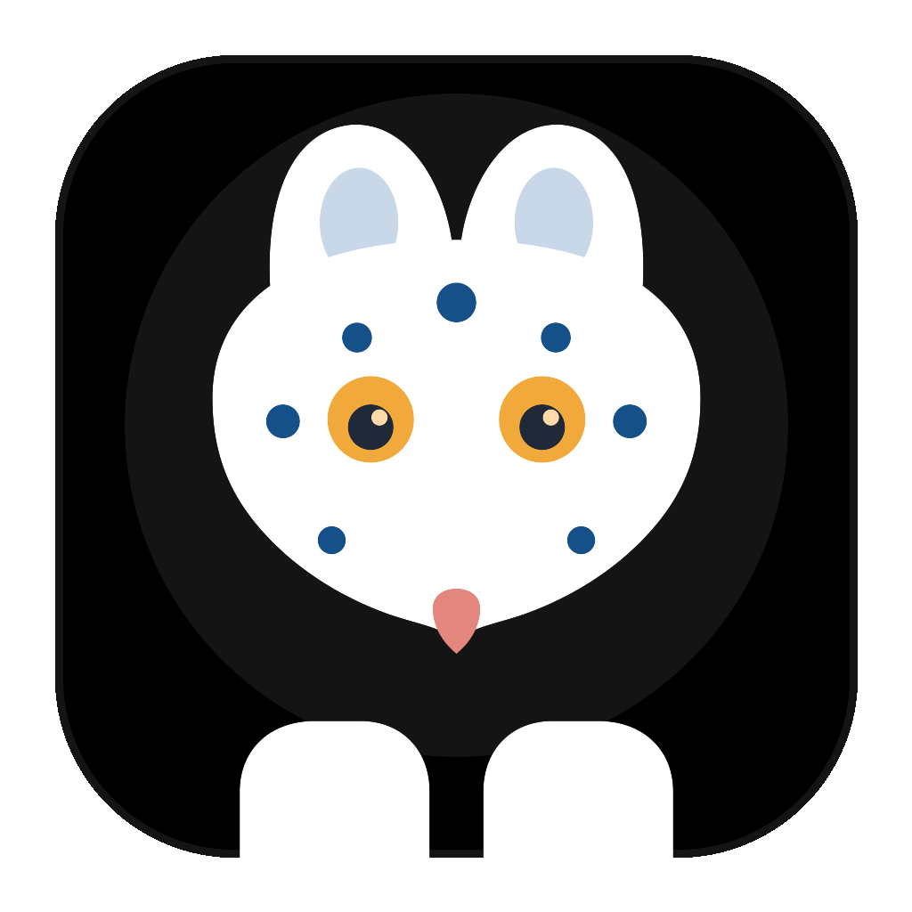
</p>

<h1 align="center">QuollDesk</h1>

<p align="center">
  <strong>🔥 基于 QuollDesk 的增强版 — AI SSH 工作台，扩展 Redis / MySQL / PostgreSQL 图形化客户端 🚀</strong><br/>
  <a href="https://quolldesk.app"><strong>quolldesk.app</strong></a>
</p>

<p align="center">
  <a href="https://github.com/artsgoofficial/QuollDesk/releases/latest"></a>
  &nbsp;
  <a href="#"></a>
  &nbsp;
  <a href="LICENSE"></a>
</p>

<p align="center">
  <a href="https://github.com/artsgoofficial/QuollDesk/releases/latest">
    
  </a>
</p>

<p align="center">
  <a href="https://artsgo.com"></a>
</p>

<p align="center">
  💝 如果 QuollDesk 对你有帮助，欢迎到 <a href="https://artsgo.com"><strong>artsgo.com</strong></a> 支持我们 — 我们的原创艺术品在线商城，每一次访问都是鼓励！
</p>

<p align="center">
  <a href="./README.md">English</a> · <a href="./README.zh-CN.md">简体中文</a> · <a href="./README.zh-TW.md">繁體中文</a> · <a href="./README.ja-JP.md">日本語</a>
</p>

---

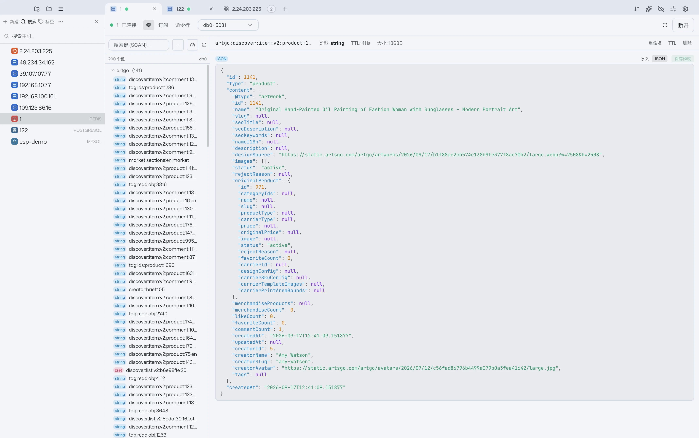

---

<a name="about"></a>
# 关于此项目

本项目基于开源项目 [NetCatty](https://github.com/binaricat/NetCatty) 扩展而来。NetCatty 原有的全部能力 — SSH 终端、SFTP、监控、工作区、内置 AI Agent — **完整保留**；在此基础上**新增了完整的数据库层**：

- 🗄️ **数据库与 Redis 图形化客户端** — Redis（单机与集群）、MySQL、PostgreSQL 三种工作台，与终端同窗口以标签页打开，每条连接均可选 SSH 隧道
- 🧠 **数据库 AI 能力** — 内置 AI 助手可感知当前打开的数据库连接：用自然语言生成 / 优化 / 修复 SQL，并可将数据库暴露给外部 MCP 客户端
- 🔄 **与上游保持一致** — QuollDesk 的基础功能（终端、SFTP、监控、主题等）行为不变

> 感谢 [@binaricat](https://github.com/binaricat) 的原版 NetCatty。本仓库由 [artsgo](https://artsgo.com) 维护。

---

<a name="database-clients"></a>
# 🗄️ 数据库与 Redis 客户端

> 🚀 **不离开终端工作区即可管理数据。** 为 **Redis**（单机与集群）、**MySQL**、**PostgreSQL** 提供完整 GUI 客户端 — 直连或经 SSH 隧道，可视化浏览与编辑数据，智能补全写查询，免手写 DDL 设计表结构。

### 🔴 Redis 工作台
- **键浏览** — 分页 SCAN 键树，db0–15 切换（实时键数统计）、类型徽章、命名空间分组、大海量键懒加载
- **类型化编辑器** — string / hash / list / set / zset 专属查看与编辑；JSON 值自动美化 + 语法高亮，且高亮状态下可直接编辑
- **键管理** — 新建、重命名、删除键；TTL 查看与编辑（实时倒计时）
- **Pub/Sub** — 订阅频道或模式，实时查看消息
- **命令行控制台** — 直接执行 Redis 原生命令，带历史记录；订阅控制类命令自动引导到专用界面
- **集群支持** — 集群节点列表与按节点访问键

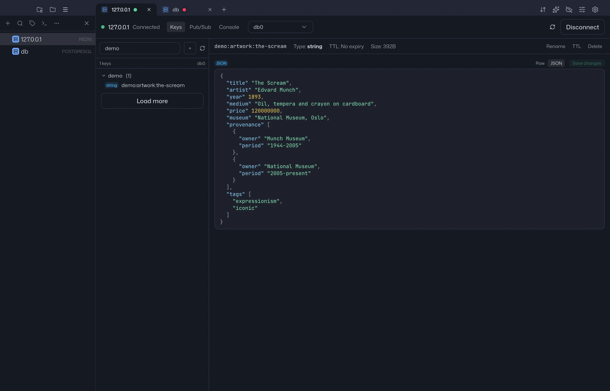

### 🐬 SQL 工作台（MySQL & PostgreSQL）
- **Schema 树** — 用户库/表/视图一目了然（自动过滤系统库），支持手动刷新
- **数据网格** — 分页、排序、多条件筛选；单元格内联编辑，暂存后事务性**应用更改**；新增/删除行；外键元数据与点击跳转
- **导入与导出** — 网格与查询结果导出 CSV / JSON / SQL INSERTS；CSV 导入向导；SQL 备份（整库或单表，流式进度）与 `.sql` 还原
- **SQL 编辑器** — 多标签、多结果集，查询历史与收藏持久化
- **智能提示** — 基于方言的关键词 / 表 / 列补全（dt-sql-parser），实时语法错误红线
- **EXPLAIN** — 编辑器内一键查看执行计划（MySQL 表格 / PostgreSQL 文本）
- **表设计器** — 可视化建表与改表，DDL 预览 + 两步确认执行
- **结构视图** — 列、类型、默认值、键与索引，附完整 `CREATE TABLE` 定义

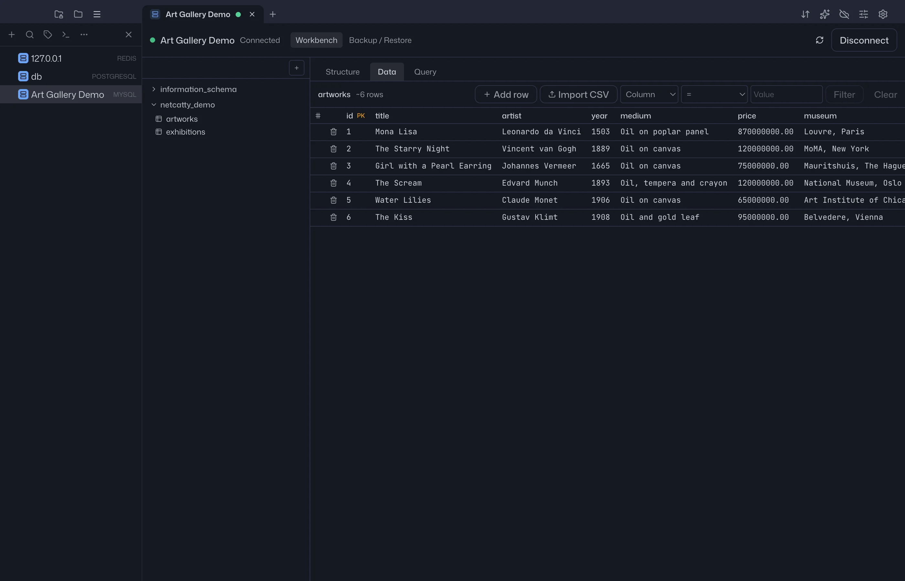

### 🤖 数据库 AI 与 MCP
- **工作台 AI 面板** — 会话级绑定当前连接；「AI 优化 / AI 修复」按钮把编辑器 SQL 转为自然语言提示，结果一键回填
- **MCP 工具** — 将当前打开的数据库连接暴露给外部 MCP 客户端（schema / 查询 / 执行 + Redis 键工具），由总开关与 Agent 权限模式统一管控

---

<a name="quoll-agent"></a>
# 🔥 Quoll Agent — 你的 IT 运维 AI 搭档

> 🚀 **用 AI 提效日常运维。** Quoll Agent 是内置 AI 助手，懂你的服务器、能执行命令、可处理复杂的多主机操作 — 全程自然对话。

### 🔥 Quoll Agent 能做什么？

- 🚀 **自然语言管理服务器** — 说出需求即可，无需记忆命令
- 🔥 **实时服务器诊断** — 对话式查看状态、日志与资源占用
- 🚀 **多主机编排** — 同时协调多台服务器执行任务
- 🔥 **智能上下文感知** — 理解服务器环境并给出针对性回答
- 🚀 **一键复杂操作** — 搭建集群、部署服务等一句话完成

### 🎬 AI 实战演示

#### 🔥 单主机 — 智能服务器诊断

让 Quoll Agent 检查服务器健康状态：自动执行正确的命令、分析输出并给出清晰结论 — 只需几秒。

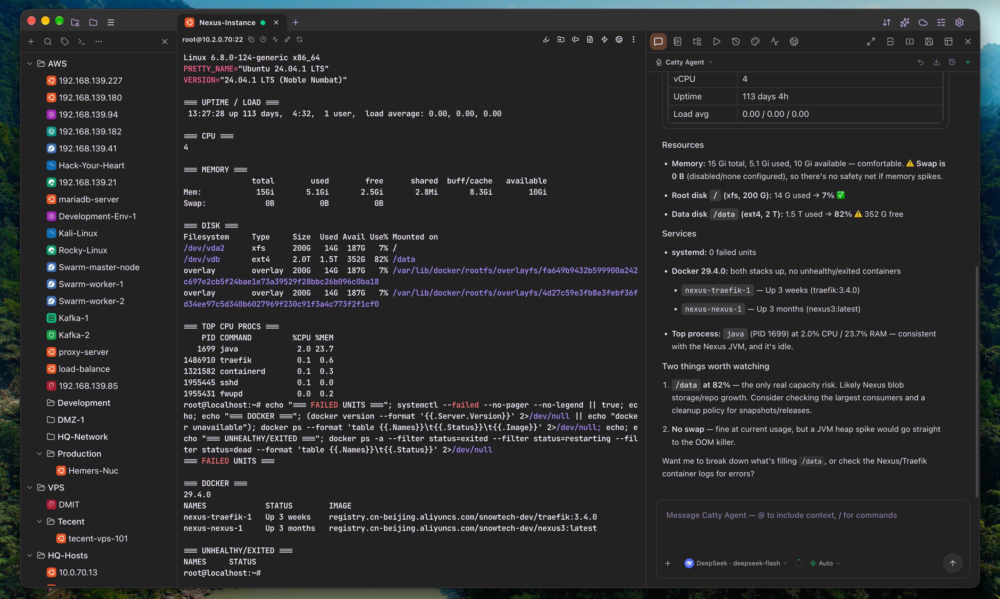

#### 🚀 多主机 — Docker Swarm 集群搭建

看 Quoll Agent 在一次对话中跨两台服务器编排 Docker Swarm 集群：初始化、令牌交换、节点加入全自动 — 你只需要说出目标。

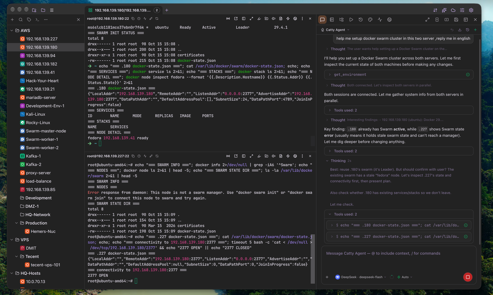

---

# 目录 <!-- omit in toc -->

- [关于此项目](#about)
- [🗄️ 数据库与 Redis 客户端](#database-clients)
- [🔥 Quoll Agent — AI 搭档](#quoll-agent)
- [基础功能（QuollDesk）](#base-features)
- [界面截图](#screenshots)
- [支持的发行版](#supported-distros)
- [快速开始](#getting-started)
- [构建与打包](#build--package)
- [技术栈](#tech-stack)
- [参与贡献](#contributing)
- [开源协议](#license)

---

<a name="base-features"></a>
# 基础功能（QuollDesk）

以下能力全部来自 QuollDesk 原版，在本版本中保持不变。

### 🗂️ Vault 主机管理
- **多种视图** — 网格 / 列表 / 树
- **快速搜索** — 快速定位主机与分组

### 🖥️ 终端工作区
- **分屏** — 水平/垂直拆分，多任务并行
- **会话管理** — 多连接并行运行，保存并恢复
- **保存当前屏幕** — 右键终端保存可见的最终文本
- **内联图片** — 渲染 Kitty graphics、SIXEL 与 iTerm 内联图片

### 📁 SFTP + 内置编辑器
- **文件工作流** — 拖拽上传/下载
- **就地编辑** — 内置编辑器快速修改
- **创建远程压缩包** — 右键选中文件/文件夹压缩为 `.tar.gz` 或 `.zip`

### 📊 监控
- CPU / 内存 / 磁盘 / 网络 / 延迟（可用时含 GPU），刷新最低 1 秒，可从监控主机直接打开终端

### 🎨 个性化
- **自定义主题** — 按喜好调整应用外观
- **关键字高亮** — 自定义终端输出高亮规则

---

<a name="screenshots"></a>
# 界面截图

## 主窗口

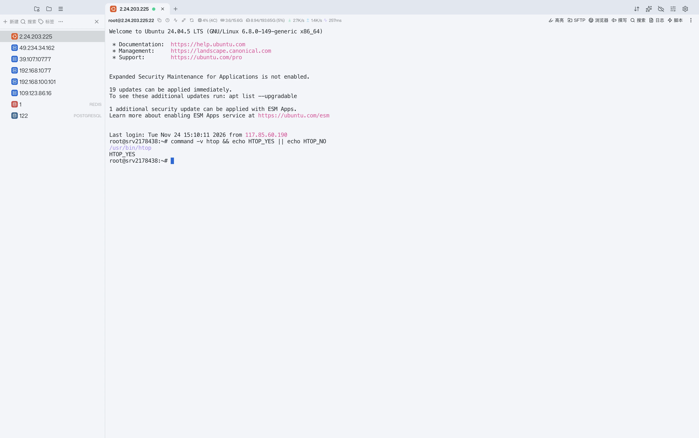

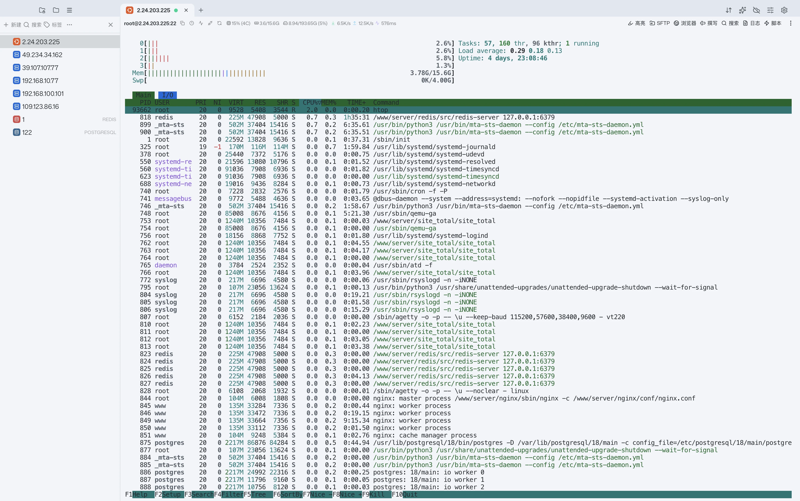

## Vault 视图

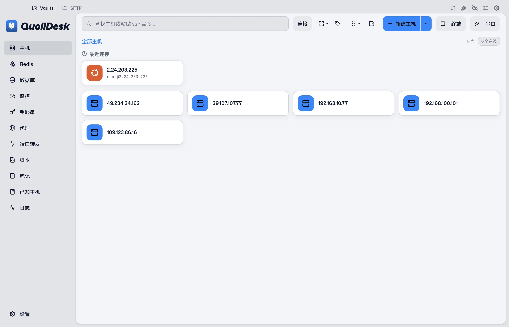

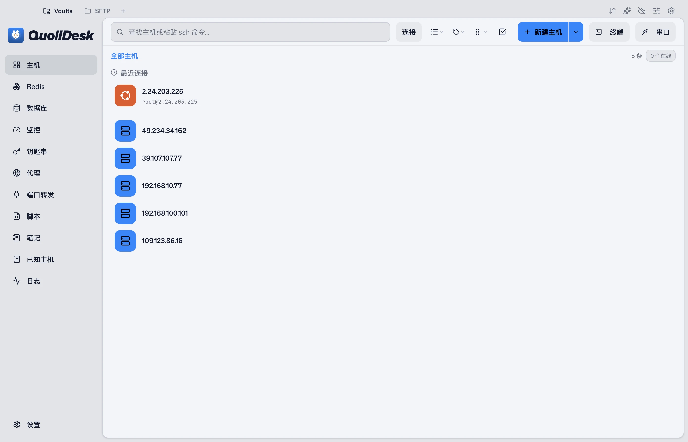

## 监控视图

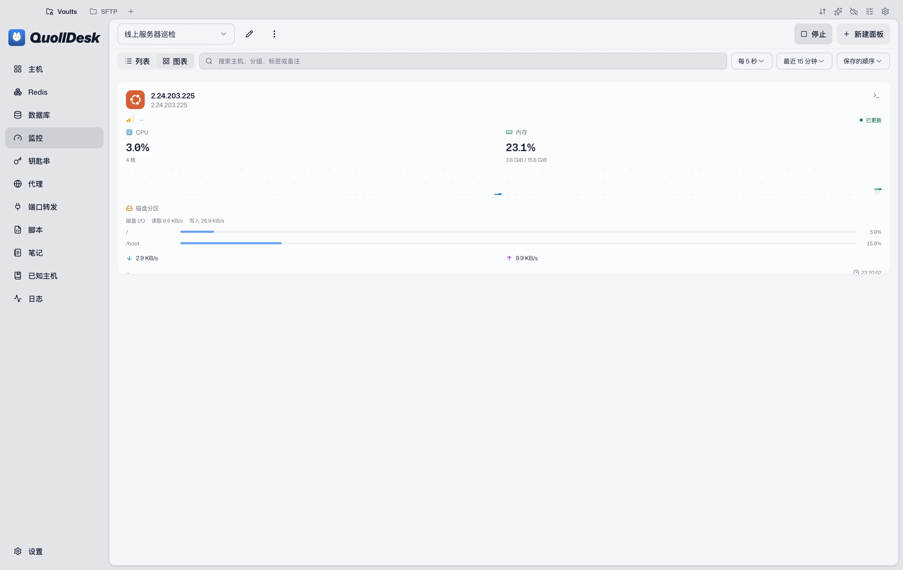

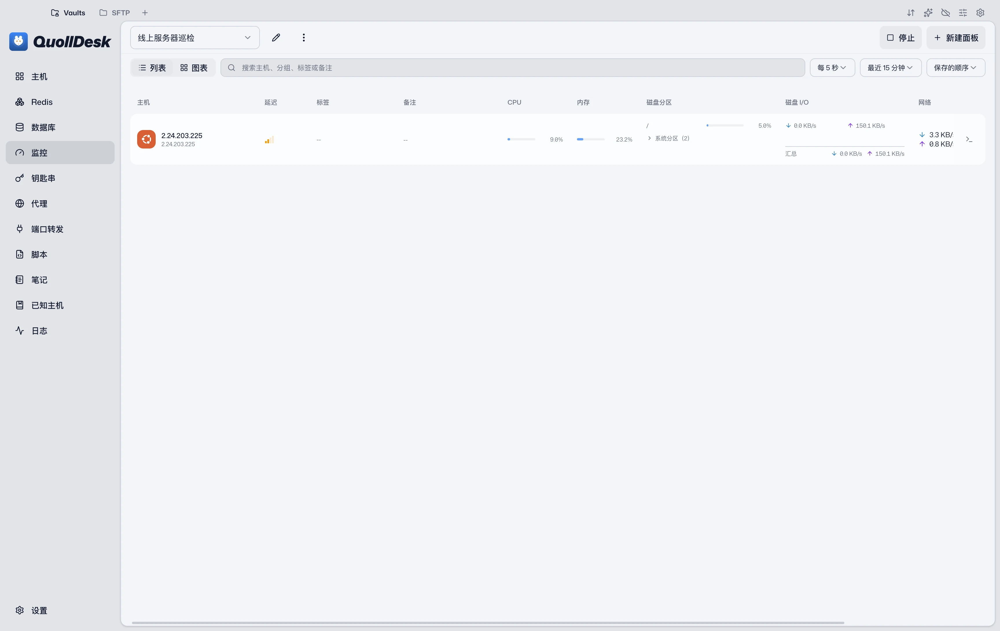

## 分屏终端

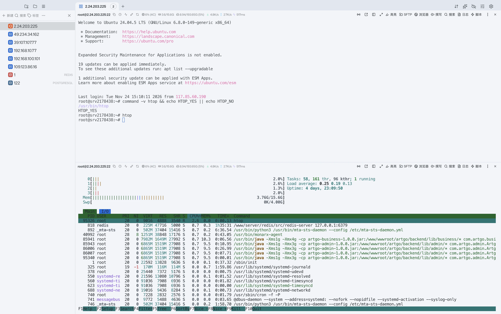

---

<a name="supported-distros"></a>
# 支持的发行版

QuollDesk 自动识别并显示已连接主机的系统图标：

<p align="center">
  
  
  
  
  
  
  
  
  
  
  
  
  
</p>

<a name="getting-started"></a>
# 快速开始

### 下载

从 [GitHub Releases](https://github.com/artsgoofficial/QuollDesk/releases/latest) 下载对应平台的最新版本。

| 系统 | 支持 |
| :--- | :--- |
| **macOS** | Universal（x64 / arm64） |
| **Windows** | x64 / arm64 |
| **Linux** | x64 / arm64 |

### 代码签名与隐私

QuollDesk 正在申请 SignPath Foundation 开源计划。获批后，覆盖范围内的 Windows 构建产物将使用 **SignPath.io 提供的免费代码签名（证书由 SignPath Foundation 签发）**。详见[代码签名政策](CODE_SIGNING_POLICY.md)与[隐私政策](PRIVACY.md)。在申请与集成完成前，Windows 版本可能保持未签名状态。

> **Windows 便携版数据**：退出 QuollDesk 后，在 `QuollDesk.exe`（zip 版）或便携启动器旁创建名为 `data` 的文件夹，下次启动 QuollDesk 会将配置存放在该目录。

> **Windows 在 QuollDesk 中打开文件夹**：安装版会在资源管理器文件夹右键菜单中加入 **Open in QuollDesk**。可在 **设置 → 系统 → Windows 资源管理器** 中开关该菜单。

> **macOS 用户**：当前版本已签名并公证。若 Gatekeeper 仍告警，请确认从 GitHub Releases 下载的是最新官方构建。

<a name="open-a-local-terminal-from-the-command-line"></a>
### 从命令行打开本地终端

`--open-terminal-path <dir>` 在指定目录打开本地终端；`--open-terminal-shell <id-or-path>` 选择 shell（如 `pwsh`、`cmd`、`wsl-ubuntu`，或 shell 可执行文件路径）。任一参数即可；若 QuollDesk 已在运行，新标签会在现有窗口打开。

Windows 需要额外的 `--` 让 Electron 转发参数：

```bat
QuollDesk.exe -- --open-terminal-shell=pwsh --open-terminal-path="D:\\proj"
```

macOS 用 `open` 启动新实例，或直接运行二进制：

```bash
open -n -a QuollDesk --args --open-terminal-shell=zsh --open-terminal-path="$HOME/proj"
/Applications/QuollDesk.app/Contents/MacOS/QuollDesk --open-terminal-shell=zsh --open-terminal-path="$HOME/proj"
```

### Scoop（Windows x64，社区维护）

安装 [Scoop](https://scoop.sh/) 后，可从社区维护的 [lemon bucket](https://github.com/hoilc/scoop-lemon/blob/master/bucket/quolldesk.json) 安装 QuollDesk：

```powershell
scoop bucket add lemon https://github.com/hoilc/scoop-lemon
scoop install lemon/quolldesk
```

### Nix / NixOS

提供 flake，封装官方 Linux AppImage：

```bash
nix run github:artsgoofficial/QuollDesk
```

### 环境要求
- Node.js 18+ 与 npm
- macOS、Windows 10+ 或 Linux

### 开发

```bash
# 克隆仓库
git clone https://github.com/artsgoofficial/QuollDesk.git
cd QuollDesk

# 安装依赖（会应用内置补丁 — 请保持 postinstall 开启）
npm install

# 启动开发模式（Vite + Electron）
npm run dev
```

---

<a name="build--package"></a>
# 构建与打包

```bash
# 生产构建
npm run build

# 打包当前平台
npm run pack

# 打包特定平台
npm run pack:mac     # macOS（DMG + ZIP）
npm run pack:win     # Windows（NSIS 安装器）
npm run pack:linux   # Linux（AppImage + DEB + RPM）
```

---

<a name="tech-stack"></a>
# 技术栈

| 类别 | 技术 |
|----------|------------|
| 框架 | Electron 40 |
| 前端 | React 19, TypeScript |
| 构建工具 | Vite 7 |
| 终端 | xterm.js 5 |
| 样式 | Tailwind CSS 4 |
| SSH/SFTP | ssh2, ssh2-sftp-client |
| PTY | node-pty |
| 数据库 | redis (node-redis), mysql2, pg, dt-sql-parser |
| 图标 | Lucide React |

---

<a name="contributing"></a>
# 参与贡献

欢迎贡献！随时提交 Pull Request。

1. Fork 本仓库
2. 创建功能分支（`git checkout -b feature/amazing-feature`）
3. 提交修改（`git commit -m 'Add some amazing feature'`）
4. 推送分支（`git push origin feature/amazing-feature`）
5. 发起 Pull Request

架构概览与编码规范见 [AGENTS.md](AGENTS.md)。

---

<a name="license"></a>
# 开源协议

本项目基于 **GPL-3.0** 协议开源 — 详见 [LICENSE](LICENSE)。

---

<p align="center">
  基于 <a href="https://github.com/binaricat/NetCatty">NetCatty</a> · 由 <a href="https://artsgo.com">artsgo</a> 扩展并维护 ❤️ · 支持我们：<a href="https://artsgo.com">artsgo.com</a> 🎨
</p>
