<p align="center">
  
</p>

<h1 align="center">QuollDesk</h1>

<p align="center">
  <strong>🔥 基於 QuollDesk 的增強版 — AI SSH 工作台，擴充 Redis / MySQL / PostgreSQL 圖形化客戶端 🚀</strong><br/>
  <a href="https://quolldesk.app"><strong>quolldesk.app</strong></a>
</p>

<p align="center">
  <a href="https://github.com/artsgoofficial/QuollDesk/releases/latest"></a>
  &nbsp;
  <a href="#"></a>
  &nbsp;
  <a href="LICENSE"></a>
</p>

<p align="center">
  <a href="https://github.com/artsgoofficial/QuollDesk/releases/latest">
    
  </a>
</p>

<p align="center">
  <a href="https://artsgo.com"></a>
</p>

<p align="center">
  💝 如果 QuollDesk 對你有幫助，歡迎到 <a href="https://artsgo.com"><strong>artsgo.com</strong></a> 支持我們 — 我們的原創藝術品線上商城，每一次造訪都是鼓勵！
</p>

<p align="center">
  <a href="./README.md">English</a> · <a href="./README.zh-CN.md">简体中文</a> · <a href="./README.zh-TW.md">繁體中文</a> · <a href="./README.ja-JP.md">日本語</a>
</p>

---

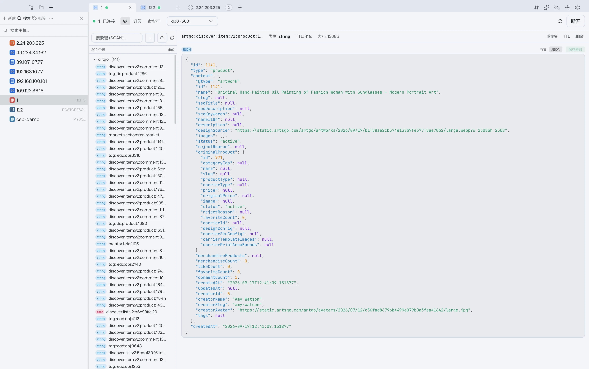

---

<a name="about"></a>
# 關於此專案

本專案基於開源專案 [NetCatty](https://github.com/binaricat/NetCatty) 擴充而來。NetCatty 原有的全部能力 — SSH 終端機、SFTP、監控、工作區、內建 AI Agent — **完整保留**；在此基礎上**新增了完整的資料庫層**：

- 🗄️ **資料庫與 Redis 圖形化客戶端** — Redis（單機、叢集與哨兵）、MySQL、MariaDB、PostgreSQL、SQLite、SQL Server 六種工作台，與終端機同視窗以分頁開啟，每條連線均可選 SSH 隧道；支援從 DBeaver / Navicat 匯入資料庫連線，從 Xshell 匯入主機
- 🧠 **資料庫 AI 能力** — 內建 AI 助理可感知目前開啟的資料庫連線：用自然語言產生 / 最佳化 / 修復 SQL，並可將資料庫暴露給外部 MCP 客戶端
- 🔄 **與上游保持一致** — QuollDesk 的基礎功能（終端機、SFTP、監控、主題等）行為不變

> 感謝 [@binaricat](https://github.com/binaricat) 的原版 NetCatty。本倉庫由 [artsgo](https://artsgo.com) 維護。

---

<a name="database-clients"></a>
# 🗄️ 資料庫與 Redis 客戶端

> 🚀 **不離開終端機工作區即可管理資料。** 為 **Redis**（單機、叢集與哨兵）、**MySQL**、**MariaDB**、**PostgreSQL**、**SQLite**、**SQL Server** 提供完整 GUI 客戶端 — 直連或經 SSH 隧道，視覺化瀏覽與編輯資料，智慧補全撰寫查詢，免手寫 DDL 設計資料表結構。連線在資料庫頁按引擎分組展示，並支援從 **DBeaver**（`.xml`）或 **Navicat**（`.ncx`）匯入既有連線。

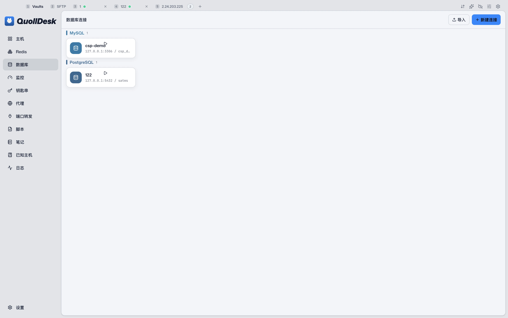

### 🔴 Redis 工作台
- **鍵瀏覽** — 分頁 SCAN 鍵樹，邏輯庫 0–65535 切換（即時鍵數統計）、類型徽章、命名空間分組、大海量鍵懶載入
- **伺服器概覽** — 每連線儀表板：伺服器資訊、記憶體與碎片率、鍵空間統計（鍵量 / TTL 覆蓋）與即時活動（每秒操作數迷你曲線、快取命中率、客戶端數）
- **類型化編輯器** — string / hash / list / set / zset 專屬檢視與編輯；JSON 值自動美化 + 語法高亮，且高亮狀態下可直接編輯
- **大鍵分析** — 按類型掃描鍵空間中的最大鍵，定位記憶體熱點
- **鍵管理** — 新建、重新命名、刪除鍵；TTL 檢視與編輯（即時倒數）
- **Pub/Sub** — 訂閱頻道或模式，即時查看訊息
- **命令列主控台** — 直接執行 Redis 原生命令，帶歷史記錄；訂閱控制類命令自動引導到專用介面
- **叢集與哨兵** — 叢集節點列表與按節點存取鍵；感知 Sentinel 拓撲

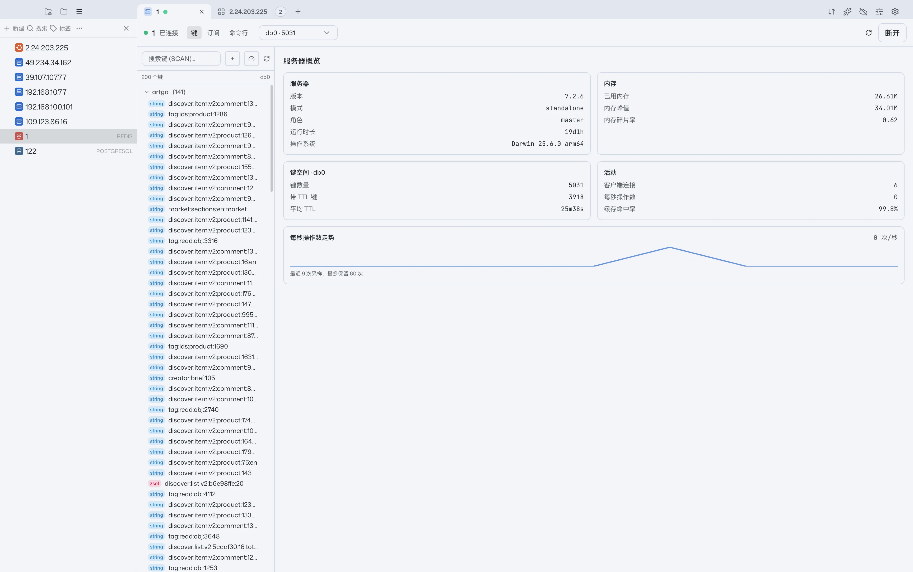

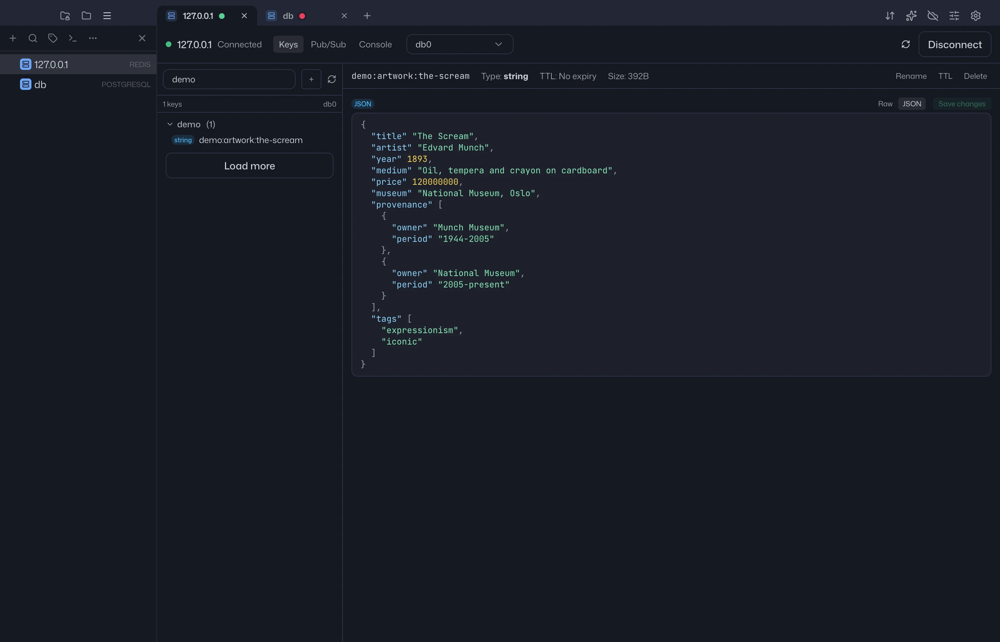

### 🐬 SQL 工作台（MySQL、MariaDB、PostgreSQL、SQLite 與 SQL Server）
- **七大工作台檢視** — 概覽、工作台、備份/還原、工作階段、**ER 圖**、鎖管理、使用者與角色，一個關注點一個檢視
- **Schema 樹** — 資料庫/Schema、資料表、檢視表一目瞭然（自動過濾系統物件），支援手動重新整理
- **資料網格** — 分頁、排序、多條件篩選、GROUP BY 彙總與記錄模式；儲存格內聯編輯，暫存後交易式**套用變更**；新增/刪除列支援批次操作；外部鍵中繼資料與點擊跳轉
- **BLOB 檢視器** — 二進位儲存格按圖片 / PDF / 十六進位開啟，文字可按 UTF-8、GB18030、CP1252 等編碼解碼
- **匯入與匯出** — 網格與查詢結果匯出 CSV / JSON / SQL INSERTS；CSV 匯入精靈；SQL 備份（整庫或單表，串流進度）與 `.sql` 還原
- **SQL 編輯器** — 多分頁、多語句結果分頁籤、繫結變數（`:name` / `?`）、SQL 格式化，查詢歷史與收藏持久化
- **智慧提示** — 基於方言的關鍵字 / 資料表 / 欄位補全（dt-sql-parser），即時語法錯誤紅線
- **EXPLAIN** — 編輯器內一鍵查看執行計畫（MySQL 表格 / PostgreSQL 文字）
- **ER 圖** — 自動版面的實體關係圖，外部鍵關係連線與欄位註解內聯展示；拖曳排版，點擊資料表直接開啟資料
- **資料表設計器** — 視覺化建表與改表，方言專屬類型清單；DBeaver 風格複合索引編輯器（DESC / NULLS / WHERE、PostgreSQL 運算式、`USING` 方式）；DDL 預覽 + 兩步確認執行
- **使用者與角色** — 管理帳號、角色與授權：PostgreSQL 角色屬性與成員關係，MySQL 權限差異比對與批次授予/回收
- **工作階段與鎖** — 即時工作階段列表可終止工作階段，鎖管理器協助阻塞分析
- **結構檢視** — 欄位、類型、預設值、鍵與索引，附完整 `CREATE TABLE` 定義

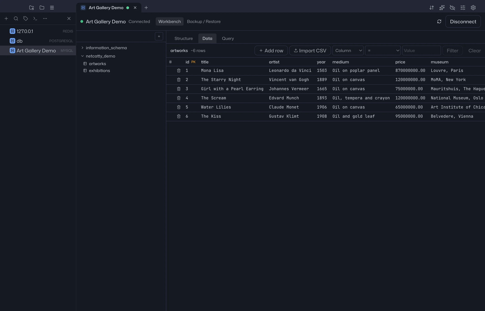

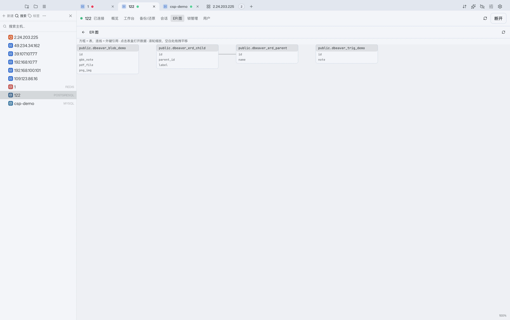

### 🤖 資料庫 AI 與 MCP
- **工作台 AI 面板** — 會話級綁定目前連線；「AI 最佳化 / AI 修復」按鈕把編輯器 SQL 轉為自然語言提示，結果一鍵回填
- **MCP 工具** — 將目前開啟的資料庫連線暴露給外部 MCP 客戶端（schema / 查詢 / 執行 + Redis 鍵工具），由總開關與 Agent 權限模式統一管控

---

<a name="quoll-agent"></a>
# 🔥 Quoll Agent — 你的 IT 維運 AI 夥伴

> 🚀 **用 AI 提升日常維運效率。** Quoll Agent 是內建 AI 助理，懂你的伺服器、能執行命令、可處理複雜的多主機操作 — 全程自然對話。

### 🔥 Quoll Agent 能做什麼？

- 🚀 **自然語言管理伺服器** — 說出需求即可，無需記憶命令
- 🔥 **即時伺服器診斷** — 對話式查看狀態、日誌與資源佔用
- 🚀 **多主機編排** — 同時協調多台伺服器執行任務
- 🔥 **智慧上下文感知** — 理解伺服器環境並給出針對性回答
- 🚀 **一鍵複雜操作** — 搭建叢集、部署服務等一句話完成

### 🎬 AI 實戰演示

#### 🔥 單主機 — 智慧伺服器診斷

讓 Quoll Agent 檢查伺服器健康狀態：自動執行正確的命令、分析輸出並給出清晰結論 — 只需幾秒。

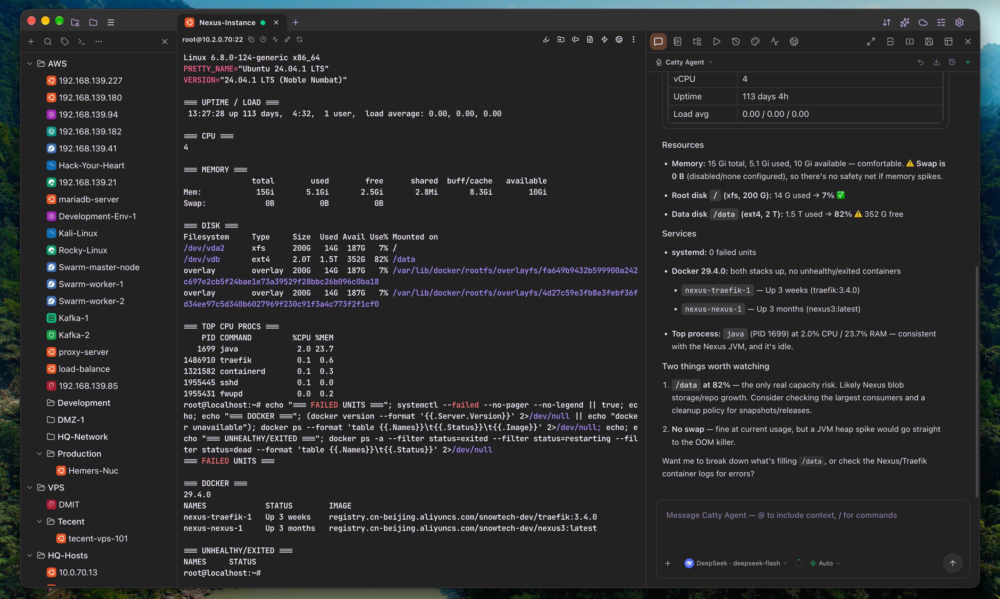

#### 🚀 多主機 — Docker Swarm 叢集搭建

看 Quoll Agent 在一次對話中跨兩台伺服器編排 Docker Swarm 叢集：初始化、權杖交換、節點加入全自動 — 你只需要說出目標。

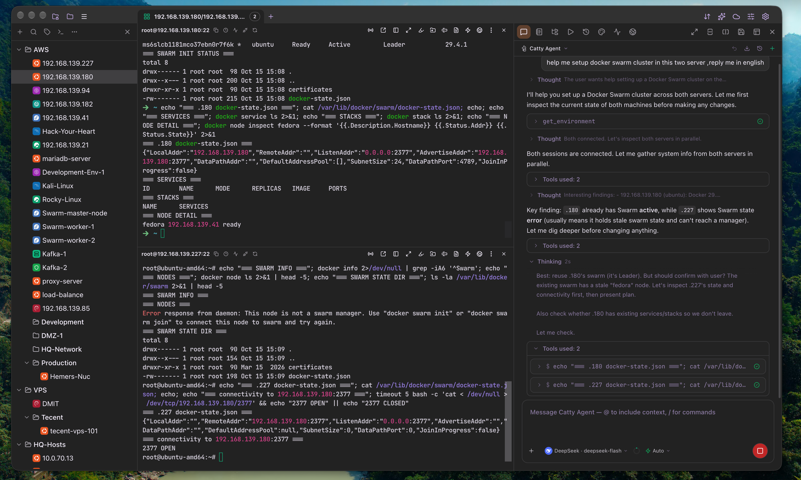

---

# 目錄 <!-- omit in toc -->

- [關於此專案](#about)
- [🗄️ 資料庫與 Redis 客戶端](#database-clients)
- [🔥 Quoll Agent — AI 夥伴](#quoll-agent)
- [基礎功能（QuollDesk）](#base-features)
- [介面截圖](#screenshots)
- [支援的發行版](#supported-distros)
- [快速開始](#getting-started)
- [建置與打包](#build--package)
- [技術堆疊](#tech-stack)
- [參與貢獻](#contributing)
- [開源授權](#license)

---

<a name="base-features"></a>
# 基礎功能（QuollDesk）

以下能力全部來自 QuollDesk 原版，在本版本中保持不變。

### 🗂️ Vault 主機管理
- **多種檢視** — 網格 / 列表 / 樹
- **快速搜尋** — 快速定位主機與群組
- **匯入** — 從 Xshell（`.xsh`）匯出匯入主機，從 DBeaver / Navicat 匯入資料庫連線

### 🖥️ 終端機工作區
- **分割窗格** — 水平/垂直分割，多任務並行
- **工作階段管理** — 多連線並行執行，儲存並還原
- **儲存目前畫面** — 右鍵終端機儲存可見的最終文字
- **內嵌圖片** — 渲染 Kitty graphics、SIXEL 與 iTerm 內嵌圖片

### 📁 SFTP + 內建編輯器
- **檔案工作流** — 拖放上傳/下載
- **就地編輯** — 內建編輯器快速修改
- **建立遠端壓縮檔** — 右鍵選取檔案/資料夾壓縮為 `.tar.gz` 或 `.zip`

### 📊 監控
- CPU / 記憶體 / 磁碟 / 網路 / 延遲（可用時含 GPU），重新整理最低 1 秒，可從監控主機直接開啟終端機

### 🎨 個人化
- **自訂主題** — 依喜好調整應用外觀
- **關鍵字高亮** — 自訂終端機輸出高亮規則

---

<a name="screenshots"></a>
# 介面截圖

## 主視窗

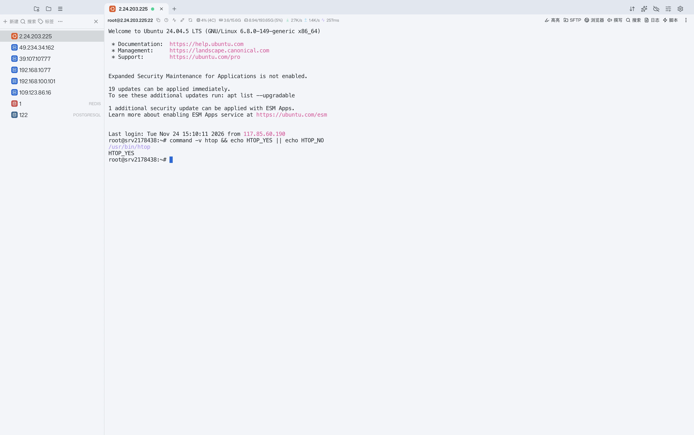

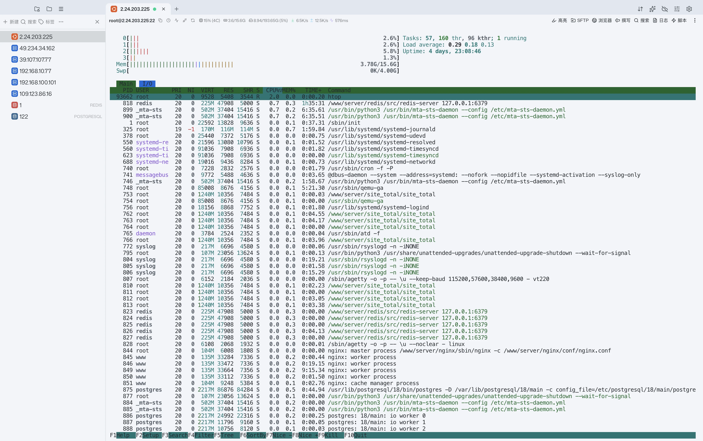

## Vault 檢視

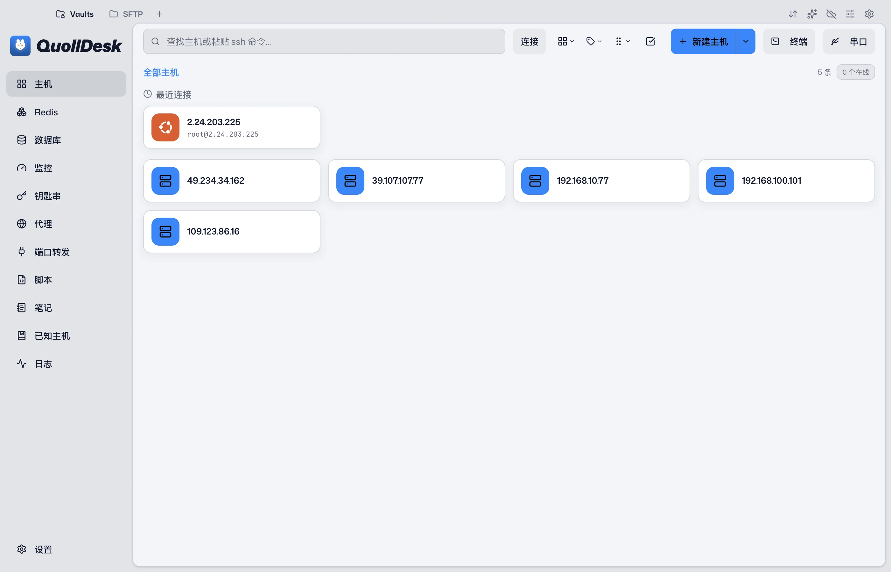

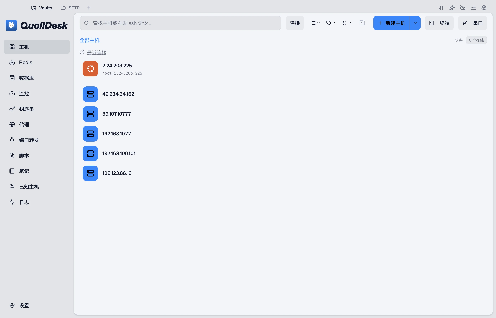

## 監控檢視

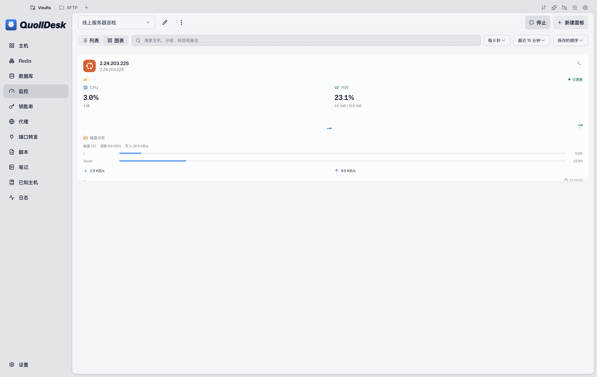

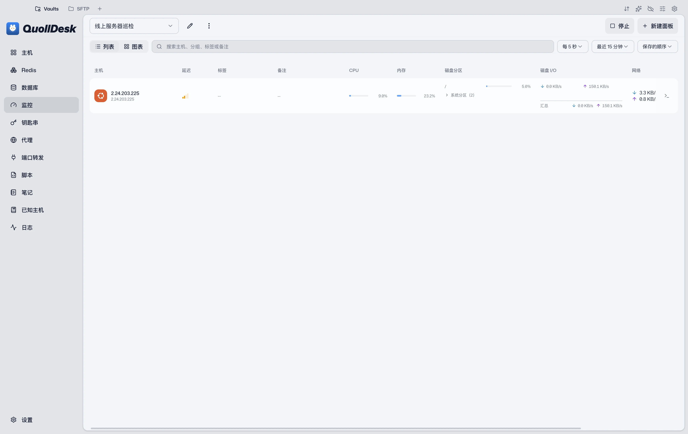

## 分割終端機

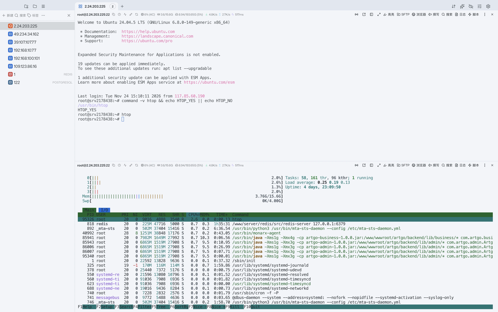

---

<a name="supported-distros"></a>
# 支援的發行版

QuollDesk 自動識別並顯示已連線主機的系統圖示：

<p align="center">
  
  
  
  
  
  
  
  
  
  
  
  
  
</p>

<a name="getting-started"></a>
# 快速開始

### 下載

從 [GitHub Releases](https://github.com/artsgoofficial/QuollDesk/releases/latest) 下載對應平台的最新版本。

| 系統 | 支援 |
| :--- | :--- |
| **macOS** | Universal（x64 / arm64） |
| **Windows** | x64 / arm64 |
| **Linux** | x64 / arm64 |

### 程式碼簽署與隱私

QuollDesk 正在申請 SignPath Foundation 開源計畫。獲批後，覆蓋範圍內的 Windows 建置產物將使用 **SignPath.io 提供的免費程式碼簽署（憑證由 SignPath Foundation 簽發）**。詳見[程式碼簽署政策](CODE_SIGNING_POLICY.md)與[隱私政策](PRIVACY.md)。在申請與整合完成前，Windows 版本可能保持未簽署狀態。

> **Windows 可攜版資料**：結束 QuollDesk 後，在 `QuollDesk.exe`（zip 版）或可攜啟動器旁建立名為 `data` 的資料夾，下次啟動 QuollDesk 會將設定存放於該目錄。

> **Windows 在 QuollDesk 中開啟資料夾**：安裝版會在檔案總管資料夾右鍵選單中加入 **Open in QuollDesk**。可在 **設定 → 系統 → Windows 檔案總管** 中開關該選單。

> **macOS 使用者**：目前版本已簽署並公證。若 Gatekeeper 仍警告，請確認從 GitHub Releases 下載的是最新官方建置。

<a name="open-a-local-terminal-from-the-command-line"></a>
### 從命令列開啟本地終端機

`--open-terminal-path <dir>` 在指定目錄開啟本地終端機；`--open-terminal-shell <id-or-path>` 選擇 shell（如 `pwsh`、`cmd`、`wsl-ubuntu`，或 shell 可執行檔路徑）。任一參數即可；若 QuollDesk 已在執行，新分頁會在現有視窗開啟。

Windows 需要額外的 `--` 讓 Electron 轉發參數：

```bat
QuollDesk.exe -- --open-terminal-shell=pwsh --open-terminal-path="D:\\proj"
```

macOS 用 `open` 啟動新實例，或直接執行二進位檔：

```bash
open -n -a QuollDesk --args --open-terminal-shell=zsh --open-terminal-path="$HOME/proj"
/Applications/QuollDesk.app/Contents/MacOS/QuollDesk --open-terminal-shell=zsh --open-terminal-path="$HOME/proj"
```

### Scoop（Windows x64，社群維護）

安裝 [Scoop](https://scoop.sh/) 後，可從社群維護的 [lemon bucket](https://github.com/hoilc/scoop-lemon/blob/master/bucket/quolldesk.json) 安裝 QuollDesk：

```powershell
scoop bucket add lemon https://github.com/hoilc/scoop-lemon
scoop install lemon/quolldesk
```

### Nix / NixOS

提供 flake，封裝官方 Linux AppImage：

```bash
nix run github:artsgoofficial/QuollDesk
```

### 環境需求
- Node.js 18+ 與 npm
- macOS、Windows 10+ 或 Linux

### 開發

```bash
# 複製倉庫
git clone https://github.com/artsgoofficial/QuollDesk.git
cd QuollDesk

# 安裝依賴（會套用內建修補 — 請保持 postinstall 開啟）
npm install

# 啟動開發模式（Vite + Electron）
npm run dev
```

---

<a name="build--package"></a>
# 建置與打包

```bash
# 生產建置
npm run build

# 打包目前平台
npm run pack

# 打包特定平台
npm run pack:mac     # macOS（DMG + ZIP）
npm run pack:win     # Windows（NSIS 安裝器）
npm run pack:linux   # Linux（AppImage + DEB + RPM）
```

---

<a name="tech-stack"></a>
# 技術堆疊

| 類別 | 技術 |
|----------|------------|
| 框架 | Electron 40 |
| 前端 | React 19, TypeScript |
| 建置工具 | Vite 7 |
| 終端機 | xterm.js 5 |
| 樣式 | Tailwind CSS 4 |
| SSH/SFTP | ssh2, ssh2-sftp-client |
| PTY | node-pty |
| 資料庫 | redis (node-redis), mysql2, pg, mssql, node:sqlite, dt-sql-parser, sql-formatter |
| 圖示 | Lucide React |

---

<a name="contributing"></a>
# 參與貢獻

歡迎貢獻！隨時提交 Pull Request。

1. Fork 本倉庫
2. 建立功能分支（`git checkout -b feature/amazing-feature`）
3. 提交修改（`git commit -m 'Add some amazing feature'`）
4. 推送分支（`git push origin feature/amazing-feature`）
5. 發起 Pull Request

架構概覽與編碼規範見 [AGENTS.md](AGENTS.md)。

---

<a name="license"></a>
# 開源授權

本專案基於 **GPL-3.0** 授權開源 — 詳見 [LICENSE](LICENSE)。

---

<p align="center">
  基於 <a href="https://github.com/binaricat/NetCatty">NetCatty</a> · 由 <a href="https://artsgo.com">artsgo</a> 擴充並維護 ❤️ · 支持我們：<a href="https://artsgo.com">artsgo.com</a> 🎨
</p>
